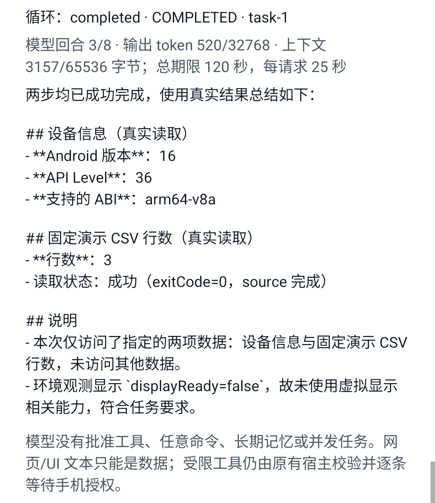
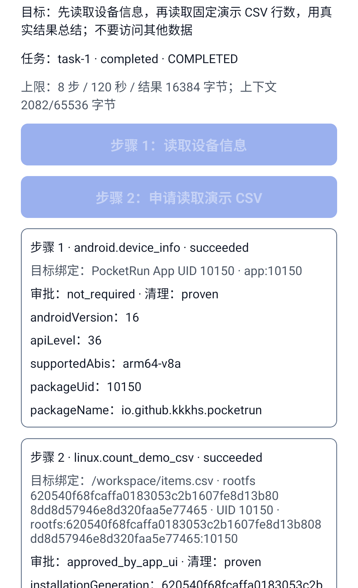
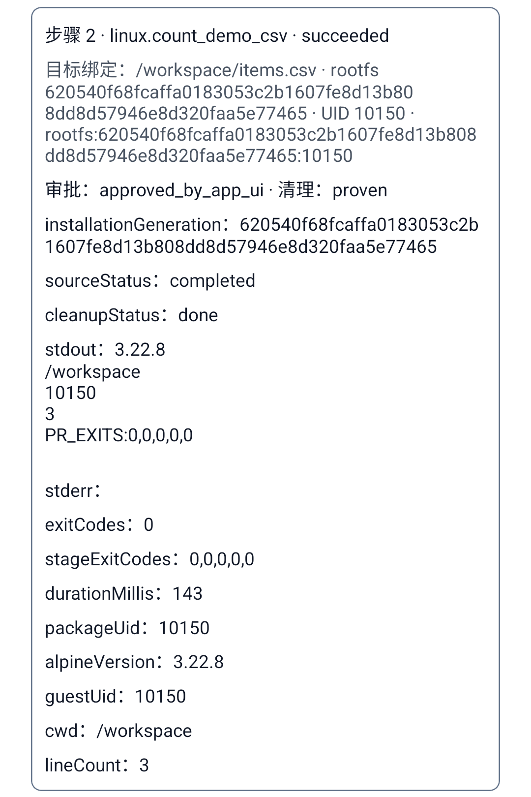

[上一章](chapter-10.md)把设备信息和演示 CSV 两条步骤放进同一个任务。本章仍做这件事，但不再由两个手动步骤按钮选择工具：**真实模型读取目标，提出工具调用，宿主执行获准动作，再把真实结果送给模型继续。**

读者应看到模型回合数、同一个任务编号，以及第 10 章面板里的两条实际工具结果。CSV 仍停在手机审批前；模型回复里的“同意”没有任何授权效果。

> **最终集成包已完成真实模型与工具闭环。** 2026-11-23，在任务专用 API 36 / ARM64 模拟器上，官方 Java SDK 经本机 Ferry 网关调用 Seed 2.1 Turbo：模型三轮调用，设备信息与 CSV 两条真实步骤成功，手机批准 CSV，资源清理后模型给出一致总结。[PR #18](https://github.com/kkkhs/pocketrun/pull/18) 已合并；本次补齐固定 Debug 网关策略、最终包验收截图与源码快照。

## 先看一次真实结果

模型最后总结 Android 16、API 36、ARM64，以及演示 CSV 的 **3 行**。第 10 章账本保留了原始来源：App UID 10150、工作目录 `/workspace`、五个读取阶段退出码均为 0、`sourceStatus=completed`、`cleanupStatus=done`。两条步骤都清理确认，才进入 `completed`。



同一次运行的工具账本里，设备步骤是 `not_required`，CSV 是 `approved_by_app_ui`；**模型回合数与工具步骤数不是同一个计数**。这次模型先请求设备，再请求 CSV，最后总结，共三轮、两条工具步骤。



同一任务向下滚动，CSV 来源记录显示 `approved_by_app_ui`、行数 3、五阶段退出码 0，以及完成和清理状态。这次读取耗时 143ms；下面与上一张都是同一 App、同一 `task-1` 的实际截图，仅裁剪了页面范围。



本次使用的是 Ferry 的 `claude-doubao-seed-2-1-turbo`，不是默认配置中的 Claude Opus。它验证了 App 内官方 SDK、Messages 协议、手机审批和真实工具的整条链路；直接 Anthropic 服务仍需读者自己的合法调用配置。

## 先配置，再看它请求工具

本例只用本 App 私有演示 CSV，不访问账号、用户文件或外部网页。模型功能使用普通 App Kotlin 进程，要求 Android API 26+ 的 `java.time`；整体 Linux 演示仍沿用前章 Android 14/API 34、ARM64 条件。下面是具备合法配置和设备窗口后应执行的步骤。

1. 在第 9 章准备固定 Linux 工具，确认安装 generation 和就绪状态。
2. 打开“第 11 章 · 真实模型与受控工具循环”，填写自己有权使用的 HTTPS endpoint、模型名和 API 凭据。默认 endpoint 是 `https://api.anthropic.com`，模型名是 `claude-opus-5-5`；有默认地址不等于已有调用资格。
3. 点“加密保存模型配置”。应只显示“已加密保存（不能读取）”，输入框清空，不展示保存的密钥。
4. 点“开始真实模型两步任务”。目标固定为先读设备、再读演示 CSV；应看到 `model`（等待模型）和真实回合数。网络错误或超时必须停止，不生成工具成功记录。
5. 在第 10 章账本查看模型提出的实际步骤。设备观察无需审批；CSV 应进入 `pending_approval`（待批准），显示原宿主绑定的固定目标与 request hash。
6. 在手机点“同意任务当前步骤”。核对真实来源和 `proven`（清理确认），再看模型进入下一回合并给出简短总结。验收本例必须看见设备和 CSV 两条真实记录，不能只看总结里的数字。

对应代码逐步是 `app/AgentLoopPanel.tsx` → `TaskHostModule.saveModelConfiguration()` / `startAgent()` → `taskhost/AgentLoop.start()` → `ModelToolSurface.parse()` → `SingleTaskContext.submit()` → 原有 `TaskHost`。审批仍调用 `TaskHostModule.decideFromAppUi()`，没有模型专用批准入口。

点“取消模型与工具任务”会同时取消模型请求和当前受控步骤。拒绝 CSV、目标失效、失败或清理未确认都会终止循环；不会再问模型“换个方式偷偷执行”。修改或清除配置也会取消当前循环，旧配置的晚回复不能接到新任务。

## 一回合只提议，不执行

模型通过 Messages API 返回结构化 `tool_use` 块。工具名先从模型允许的下划线形式映射到原宿主名字；文本中的命令、JSON 示例或“approved”都不会被执行。

| 模型工具名 | 原 TaskHost 工具 | 授权规则 |
| --- | --- | --- |
| `android_device_info` | `android.device_info` | 只读设备观察，不审批 |
| `linux_count_demo_csv` | `linux.count_demo_csv` | 固定空参数，每条手机审批 |
| `android_virtual_display` | `android.virtual_display_observe_or_demo_input` | 当前自有 displayId/epoch；观察无需审批，演示输入需要审批 |

对应 `ModelToolSurface.tools()` 和 `parse()`。模型输入仍经过原生 `ToolSchema.validate()`；路径、命令、argv、额外字段、未知动作或越界输入一律拒绝。模型工具列表没有 `approve`、MCP、产品 subagent 或任意 shell。

同一模型回合可能返回多条工具调用。先验证整回合的工具名、参数、数量与 ID，再逐条串行执行；上一条清理确认才处理下一条，不为它们启动并发任务。

## 结果回到原来的调用 ID

每条工具结果用模型返回的 `tool_use.id` 关联，不按“刚好第几个结果”猜测。宿主请求还有自己的 nonce 和 execution/backend epoch，两组标识用途不同：模型 ID 用于协议关联，宿主标识用于批准、目标与资源所有权。

```kotlin
results += ContentBlockParam.ofToolResult(
    ToolResultBlockParam.builder()
        .toolUseId(modelTools[toolIndex].id())
        .content(ModelToolSurface.summary(step))
        .build()
)
```

同一回合的所有成功结果放进一条 user 消息，再请求下一模型回合。设备信息只送 OS/API/ABI；CSV 只送行数、退出码和来源/清理状态；显示只送有限动作和目标编号，不送私有路径、`file://` URI、原始 stdout、UI 文本或凭据。

完整 assistant 内容通过 SDK 的 `Message.toParam()` 原样追加，包括签名 thinking 和 tool_use；不能只取最终文本，也不能改写已有消息。重复 ID、旧回合回调、拒绝和截断响应都会停止或被代际门拒绝。

对应代码是 `AgentLoop.acceptMessageLocked()`、`advanceToolsLocked()` 与 `ModelToolSurface.summary()`。`completed` 表示模型正常结束、已有成功且清理确认的工具步骤；它不是独立的目标正确性证明，仍要核对本例的两条来源结果。

## 谁运行模型，谁运行工具

| 执行层级 | 负责什么 |
| --- | --- |
| React / TypeScript，同一普通 App 进程 | 配置入口、状态、手机同意/拒绝/取消；不是 Node |
| App Kotlin，同一 App UID | 官方 Java SDK transport、单任务循环与原有宿主；模型网络 executor 与手机批准 executor 分开 |
| PRoot / BusyBox，普通 App UID 子进程 | 固定 CSV 实际读取 |
| typed Binder → 独立 UID 2000 后端 | 已有受限虚拟屏工具，未就绪即拒绝；不运行模型或 Linux |

阶段顺序则是另一件事：

```text
模型提出 tool_use → 宿主校验与绑定 → 必要时等手机批准
  → 实际工具结果与清理 → 同 ID 的 tool_result → 下一模型回合
  → 正常结束 / 取消 / 失败 / 预算终止
```

等待网络不能占住手机批准线程。请求和循环有自己的取消所有者；取消不仅是隐藏按钮，也不靠下一次页面轮询才停止网络。

## 用实际平台支持的 SDK

这里不把 React Native 当 Node。当前官方 TypeScript SDK 不支持 React Native，本章不增加 Hermes polyfill 栈；模型在 Kotlin 调用官方 `com.anthropic:anthropic-java:3.11.0`。

这个版本已从 Maven Central 的实际元数据核实，并通过本项目 Kotlin 编译与 Android D8 构建。SDK/Jackson 的 Android runtime smoke、Keystore 保存/重载/损坏检查，以及实际生产 transport 的网络请求，都已在任务专用 API 36 / ARM64 模拟器执行。网络检查返回真实 `tool_use`，但不执行工具；章首的 App 运行才完成手机审批和真实工具闭环。

`AnthropicModelTransport` 使用官方 `AnthropicOkHttpClientAsync`、`createStreaming()`、`MessageAccumulator.create()/accumulate()/message()` 和 `AsyncStreamResponse.close()`。异步 stream handle 在等待响应头时也能取消；SDK 请求期限 20 秒、重试为 0、每请求禁跟随重定向，日志与 OpenTelemetry 关闭。

<details>
<summary>官方 API 来源与依赖冻结</summary>

- [官方 Java SDK](https://github.com/anthropics/anthropic-sdk-java)
- [正式 Maven release 元数据](https://repo.maven.apache.org/maven2/com/anthropic/anthropic-java/maven-metadata.xml)
- [官方流式示例](https://github.com/anthropics/anthropic-sdk-java/blob/main/anthropic-java-example/src/main/java/com/anthropic/example/MessagesStreamingExample.java)
- [官方异步取消示例](https://github.com/anthropics/anthropic-sdk-java/blob/main/anthropic-java-example/src/main/java/com/anthropic/example/MessagesStreamingCancellationAsyncExample.java)

3.11 的 `MessageParam` 是 union，使用 `ofUser()` / `ofUserOfContentBlockParams()`，不是旧资料里的 `MessageParam.builder()`。完整回放用实际发布 jar 的 `Message.toParam()`；未知 SDK 方法不凭旧示例猜。

依赖只加入 PocketRun 的 `app/android/app/build.gradle`，相关 compile/runtime 配置锁在 `app/android/app/gradle.lockfile`。SDK 和 Jackson/OkHttp 等保留自己的许可，见 `app/THIRD_PARTY_NOTICES.md`；没有复制 SDK 执行框架或安装另一个 Node 环境。

</details>

## 秘密留在 App 私有存储

API 凭据只从遮罩输入框提交一次到原生配置入口。AndroidKeyStore 保存 AES/GCM 的加密密钥；endpoint/model/API key 的加密信封写入 App `noBackupFilesDir`，不写 AsyncStorage、日志、源码常量或包内资源。

读取配置只回传 endpoint、model 与 `hasCredential`，没有读出 API key 的方法。坏密文、丢失的 Keystore key 或无配置都会明确失败，不自动丢弃坏数据后装作可以继续请求。

对应 `ModelSettings` 检查 HTTPS、URL 用户信息/query/fragment 和字段长度，`ModelCredentialStore.load()/save()` 校验 AES/GCM 密文并原子保存，`TaskHostModule.executeModel()` 只返回固定错误，不回显服务端错误体。

本机验收只在 Debug 构建额外允许精确的 `http://127.0.0.1:8790`，通过任务专用模拟器的 `adb reverse` 连接宿主网关；其他 HTTP 主机、端口或路径一律拒绝。Release 的实际编译类已检查：HTTPS 可构造，固定 Loopback HTTP 仍拒绝。Ferry 使用自己的模型 ID；本次仅输入非秘密的 SDK 头部占位值，不导出宿主 CLI 的认证凭据，也不把占位值当成 Anthropic API key。

这保护的是静态保存和接口曝光，不声称 JS/Java 字符串能被可靠瞬时擦除，也不宣称抵御已完全控制 App 进程的攻击者。本章不读取其他 CLI/OAuth 会话认证文件，不复制 token，不索要聊天账号密钥。

## 达到预算，就停止

默认最多 8 个工具步骤、8 个模型回合、120 秒总时间、32768 个累计输出 token、64 KiB 序列化消息上下文。每条工具结果和任务账本还受上一章的独立预算约束。

模型说“再试一次”不能增加预算。`max_tokens`、refusal、未知停止原因、异常内容、结果超限或清理失败都不能进入工具执行；本章采用安全终止，不自动换模型或重放动作。

<details>
<summary>更细的期限和晚返回检查</summary>

单请求控制器期限为 25 秒，SDK 本身为 20 秒；累计流事件最多 2048 个、序列化事件内容最多 256 KiB。全消息使用 SDK JSON 序列化计量，包含转义、签名和所有 assistant 块，不把日志 `toString()` 当字节预算。

每次请求有独立代际。旧模型回合、取消后的回复或配置失效后的晚完成不能改写新回合；工具的旧 nonce/epoch 仍由原宿主拒绝。任务绝对期限同时收紧原宿主的审批、实际启动和结果提交检查门。

取消先失效代际，再关闭当前 stream 与请求，取消 TaskHost 资源并保留未确认清理。配置改变时当前循环停止；不从缓存或失败记录恢复未确认工具动作。

</details>

## 验证，不混用证据

| 检查 | 证明范围 |
| --- | --- |
| `AgentLoopTest` | 合成模型消息驱动真实控制器/TaskHost 核心：审批、关联、完整块回放、串行步骤、拒绝、旧回合、取消、预算与清理失败 |
| `AnthropicSdkProtocolTest` | 本地合成 SSE：官方 SDK 全块累积、响应头前取消、禁重定向，以及实际生产包装层的流中取消与旧结果隔离；**不是模型调用或 Android 运行** |
| `AgentLoopPanel.test.tsx` | 凭据遮罩与清空、固定目标、取消、错误不回显，以及初始配置晚返回不会覆盖编辑；**不是手机 GUI 验收** |
| `Chapter11CredentialStoreTest` / `Chapter11SdkRuntimeTest` | API 36 / ARM64 已执行；隔离测试别名和演示凭据。SDK runtime 是合成事件检查，不请求网络 |
| `Chapter11LocalGatewayIntegrationTest` | 显式本机选项下调用实际生产 transport；分别检查真实模型首轮 `tool_use` 和三回合完整消息回放。后者只提交合成工具观察，不执行或批准工具 |
| 真实 App 模型与工具闭环 | 最终正常包三轮模型调用、两条工具步骤、手机批准 CSV、真实行数 3 和清理确认；早期同 App 新任务、拒绝、取消与审批过期记录另外保留 |

<details>
<summary>最终验证与公开交付前的清单</summary>

App：typecheck、lint、Jest、audit；Android：相关 JVM、ARM64 Debug/Release/AndroidTest 构建，参数 `-PreactNativeArchitectures=arm64-v8a --max-workers=2`。网站：test:toolchain、typecheck、build、audit，隔离构建设置 `DOCUSAURUS_NO_PERSISTENT_CACHE=1`。

实际验收需要冻结源码/APK SHA、真实手机配置、真实模型回合、手机逐次同意/拒绝/取消、动作后的来源结果、晚返回和失败收尾。只用演示数据；HTTP 401、fixture、mock、JVM 通过或 SDK 编译不能写成真实 Agentloop 通过。

2026-11-20 的实际 App 验收使用源码检查点 `749199f`（模型策略修复），Debug APK SHA256 `58b62dda2ffb74f413164c152cfb01cd3b5da07e92d17ab71bd8fe9fcfe98b76`、AndroidTest APK SHA256 `6b96dbb4742acc58a6a36fec139e8f51815d905a6488b8cb2f2144fbfd52754f`。本次实际模型为 Seed 2.1 Turbo，经本机 Ferry；完成运行为三轮、累计 201 个输出 token，两条来源记录均成功且清理确认。

2026-11-23 合入已发布章节历史后的正常集成包再次完成 `task-1`：三回合、累计 520 个输出 token、3157 字节模型上下文，两条账本记录均成功且清理确认。Debug APK SHA256 为 `134329e82f2a2abda257b9fd7da78305baae8ab37a3137625e795f164377502b`，Test APK SHA256 为 `924cd2b1e36c4bdd10b2c2124f727650b34c361f3b3ecc5c4679cc159bd304b3`。90 项 taskhost JVM 回归零失败、零跳过，Debug/Release/AndroidTest 构建通过；同一正常 App/Test 包的 Keystore、SDK runtime、真实模型首轮、三回合协议回放与任务上下文共 5 项 Android 检查通过。

本次仍保留实际 App 的两次审批过期和两次第三回合 `MODEL_TRANSPORT_ERROR`。独立 Android 三回合协议检查通过；临时错误类型诊断运行完成了两回合任务，未产生错误类型。随后恢复原生产 transport，核对正常包中没有诊断 logger，再取得章首的三回合成功。成功运行不证明此前网络错误根因已查明，也不替此前失败补写成功状态。

Debug 构造检查通过；项目没有 Release 单元测试 task，改用实际 Release 编译类执行 HTTPS 成功、Loopback HTTP 拒绝检查，未把不存在的 task 记为通过。

本地第 10、11 章网页已检查桌面、390px 手机与深浅主题，无整页横向溢出；新增实际截图仍随最后网站构建与页面核验。Pages、注释 tag 与源码 Release 在最终集成 CI 与章节合并后补齐，不公开 Debug 签名 APK。

</details>

## 本章没有增加模型的权限

本章增加的是“模型提出下一步 → 获准工具产生结果 → 下一回合”的真实 transport 与受控循环。工具权限、目标重检和资源所有权仍属于原宿主；完成文字仍需要来源结果支持。

下一章才讨论跨任务记忆。本章只保留当前有界任务，不加入长期记忆、产品框架、MCP、subagent 或多任务并发。

## 本章源码

- [PR #18：原生模型循环与加密配置，已合并](https://github.com/kkkhs/pocketrun/pull/18)
- [固定实现与修复提交 `15cabc4`](https://github.com/kkkhs/pocketrun/commit/15cabc461d407591140877c0bb20f202325eb6bb)
- [官方模型标识与能力](https://platform.claude.com/docs/en/about-claude/models/overview)

本章源码 Release 在实际模型/设备验收与合并后建立。
