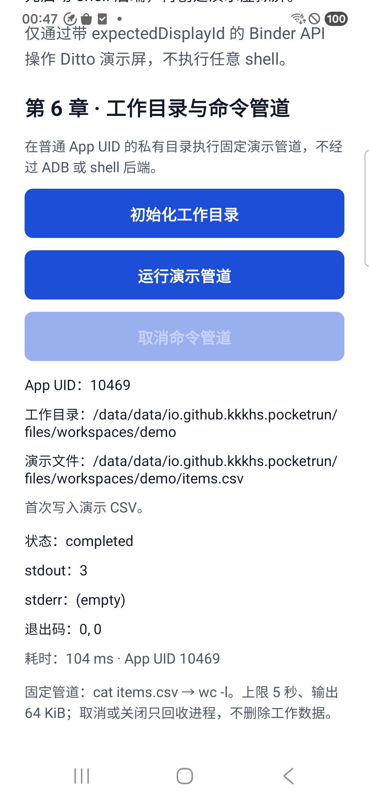

> **本地开发草稿，尚未发布。** 已在授权云真机验证命令、文件、生命周期专项，以及实际界面的初始化和运行结果。各批次证据分别记录，不能把编译、原生测试或截图混成一次验收；源码发布与线上检查仍待完成。

上一章，我们已经能看见虚拟屏里的页面，找到输入框、填入文字，再重新观察结果。

这一章开始另一条通道：**在 PocketRun 的私有工作目录里准备 `items.csv`，把文件内容交给第二个命令，得到行数，再确认两个命令都成功结束。** 这里先不把文件内容填进 App，也不接 Agent。

第一次初始化会准备这份文件：

```csv
name,quantity
apple,2
banana,3
```

它有三行：一行表头、两行商品。演示的预期结果是：

```text
状态：completed
stdout：3
stderr：(empty)
退出码：0, 0
```

**`3` 是文本行数，不是三条商品，也不是商品数量的总和。** 本章的 `wc -l` 数的是换行符；这份演示文件的最后一行也以换行结束。



这张截图来自实际运行的 PocketRun：点初始化，再点运行并重新观察结果。它证明界面和原生桥接这一轮正常工作，不单独证明取消、超时或 App 死亡；那些场景另有设备测试。

## 先在界面跑一遍

只在自己拥有或明确获授权的演示设备上练习，使用本地第 6 章源码构建的 App。公开的第 5 章源码快照还没有这个面板。

1. 打开“第 6 章 · 工作目录与命令管道”，点“初始化工作目录”。应看到 App UID、工作目录、演示文件，以及“首次写入演示 CSV”。
2. 点“运行演示管道”。第一次使用未修改的演示文件时，应得到上面的 `completed`、`3`、空 stderr 和两个 `0`。
3. 再次点“初始化工作目录”。应提示“保留已有演示文件，没有覆盖”。随后再次运行，检查结果仍与文件内容一致。
4. 运行尚未结束时，可以点“取消命令管道”。取消请求发出后，继续等待原运行的最终结果，不把按钮点击本身当作进程已经结束。

固定的三行文件通常很快就读完，未必来得及手动取消。若提示“管道已结束，没有可取消的任务”，说明当前已没有运行中的管道，不能据此宣称测到了取消；慢命令的取消由专门测试验证。

初始化失败、模块未注册、结果为 `failed`、`timeout` 或 `output_limit` 时，先停止核对错误，不把残留输出当作完成。已有文件不会被重新写回演示内容，所以修改过的文件不一定再输出 `3`。

云设备上的调试 APK 也需要能真正加载 JavaScript。本例在 `app/android/app/build.gradle` 的 `react` 配置中为调试包打入 bundle，不要求读者或云设备连到开发机 Metro。只有 App 能启动、按钮可操作并显示结果，才算界面验证；仅 APK 安装成功还不够。

对应代码：`app/WorkspacePanel.tsx` 的 `perform()` 分别调用 `prepareWorkspace()` 和 `runDemoPipeline()`，`cancel()` 调用 `cancelPipeline()`；页面展示返回的状态、stdout、stderr 和各阶段退出码。调用约定在 `app/specs/NativePocketRunWorkspace.ts`，没有命令字符串或任意路径参数。

## 这次由谁执行

这一章不需要先启动第 3 章的 shell 后端，也不需要无线 ADB 配对。

| 代码或进程 | 做什么 | 执行身份 |
| --- | --- | --- |
| React / TypeScript 页面 | 发起固定演示，展示结果与取消入口 | 普通 App 进程 |
| App Kotlin | 准备目录、选择命令、持有进程与输出通道 | 同一个 App 进程、App UID |
| 两个 toybox 子进程 | 一个读文件，一个数行数 | 独立子进程，仍是同一个 App UID |

`ProcessBuilder` 启动子进程，不改变执行身份。它不会因为执行了系统自带的命令，就得到 root 或 shell UID 2000。

**手机操作通道与文件命令通道分开。** 前章的系统操作仍走 App Kotlin → typed Binder → shell 后端；本章直接由普通 App Kotlin 启动命令，不经过那个后端。电脑上的 ADB 可以用于开发安装和测试，但不在本章产品运行的数据路径里。

下面提到的 Kotlin 文件位于 `app/android/app/src/main/java/io/github/kkkhs/pocketrun/`。它们目前是本地开发源码；公开源码链接的收口方式见文末，不预先链接尚不存在的第 6 章 tag。

## 准备目录，不覆盖已有文件

`WorkspaceModule.prepareWorkspace()` 把 App 的 `filesDir` 交给 `WorkspaceSession`。`WorkspaceSession.prepare()` 在它下面准备 `workspaces/demo`，文件名固定为 `items.csv`。

这是 App 的私有文件区域，不是主机上的当前目录，也不是外部存储。目录只允许所属 UID 读写和进入，首次创建的文件只允许所属 UID 读写。

首次写文件时，先写到同一目录里的临时文件，完整写入后同步文件内容，再把它作为 `items.csv` 发布。**只有目标尚不存在时才允许发布，不能先检查“没有文件”，随后无条件覆盖。**

对应代码：`WorkspaceSession.publishSample()` 写入并同步临时文件；`AtomicSamplePublisher.publish()` 在 Android 上调用一个很薄的 JNI 方法，完成“不替换已有目标”的原子改名。若另一个操作在这期间创建了 `items.csv`，保留它，再检查它是否是允许的文件。

每次准备与运行都会检查目录和文件是否仍在预期位置，拒绝符号链接逃逸、失效文件和超过 64 KiB 的文件。取消或关闭会话不会删除已经存在的工作数据；重新初始化也不会把用户改过的 CSV 还原。

<details>
<summary>首次写入中断后怎样恢复，为什么 Android 不用硬链接</summary>

`WorkspaceSession.publishSample()` 使用 `.pocketrun-sample-*.tmp` 临时文件，先设置私有权限，再通过 `FileOutputStream` 写入完整 CSV，调用 `output.fd.sync()`，最后发布目标。

Android 路径是 `AtomicSamplePublisher.publish()` → `renameNoReplace()` → `app/android/app/src/main/cpp/pocketrun_fs.cpp` 中的 JNI 方法。它调用平台 `renameat2`，使用 `RENAME_NOREPLACE` 语义：成功才产生目标；`EEXIST` 表示保留已存在目标；其他错误明确失败，不降级为覆盖式改名，也不改变 UID 或系统保护设置。

最早的 Android 验证曾在普通 App UID 下调用 `Files.createLink()`，真实返回 `AccessDeniedException`。这是旧实现的失败记录，不是现有生产路径。非 Android JVM 分支仍使用硬链接验证相同的 no-replace 约定，但它通过不代表 Android JNI 已通过。

如果 App 在同步临时文件之后、发布目标之前被 `SIGKILL`，`finally` 不会执行。下一次 `prepare()` 只清理演示目录中符合内部临时命名、是普通文件且未经过符号链接的残留，然后重新准备完整样本；已有 `items.csv` 仍不覆盖。这不是“进程死亡时所有清理代码都能运行”，也不等于已经验证设备突然断电后的持久性。

</details>

## 把第一个命令的输出交给第二个

`WorkspaceSession` 在 Kotlin 中固定选择两组参数：

```kotlin
listOf("/system/bin/toybox", "cat", "items.csv")
listOf("/system/bin/toybox", "wc", "-l")
```

`cat` 读取文件，把内容写到自己的标准输出；`wc -l` 从标准输入读取这些内容，再把行数写到自己的标准输出。App Kotlin 负责把前者的输出搬到后者的输入，并给两者设置同一个工作目录。

`items.csv` 是相对文件名，但它不会依赖某个碰巧正确的默认目录。`CommandPipeline.execute()` 明确调用 `ProcessBuilder(command).directory(directory).start()`；`WorkspaceSession.runDemo()` 在启动前再次检查工作文件。

传完文件后，Kotlin 关闭第二个命令的输入，让它知道不会再有数据。否则 `wc` 可能一直等待，不能得到最终行数。

**这是参数数组，不是 shell 源码。** 产品演示不调用 `sh -c`，JavaScript 不能指定可执行文件、参数、目录或重定向。本章还没有 PRoot、Alpine、交互终端或任意命令工具。

## 检查输出，也检查两个退出码

只看到 stdout 为 `3` 还不够。两个命令都要结束，两个退出码都要是 `0`；前一阶段失败不能被最后一阶段的 `0` 隐藏。

`CommandPipeline.execute()` 返回 `status`、stdout、合并的 stderr、各阶段退出码和耗时。`WorkspaceModule.runDemoPipeline()` 将它们转成普通数据，再通过 Promise 交回 React。

stderr 是命令的错误输出通道，本章单独展示它；失败状态、非零退出码和异常仍须分别检查。这个演示的正常结果应当是空 stderr，但不能给所有未来工具规定“只要 stderr 有字就失败”。

为避免命令输出塞满通道后互相等待，Kotlin 会及时读取最终 stdout 和每个阶段的 stderr，同时传递中间数据。

<details>
<summary>输出预算与返回文字的边界</summary>

`CommandPipeline` 最多运行两个阶段，每阶段参数数组最多八项。中间传输、最终 stdout 和合并 stderr 各有独立的 64 KiB 预算；不是把它们合成一个无限增长的字符串。

`copyLimited()` 管中间传输，`readStream()` 与 `LimitedOutput` 管输出收集。超过预算时终止本次进程并返回 `output_limit`，不能把截断结果标为 `completed`。

返回值是文字，不是无损二进制接口。无效 UTF-8 字节转成替换字符后，重新编码可能比原字节更长，因此 `LimitedOutput.text()` 还检查最终文字的 UTF-8 字节数，在字符边界内截断并标记 `output_limit`。真机二进制 stdout、stderr 用例均记录返回 65535 UTF-8 字节，没有超过 65536 字节预算。

</details>

## 取消后，等资源真正结束

原生模块一次只接受一个工作目录操作。执行命令前先预留这次运行，再排入 worker；因此在真正启动子进程前发出的取消，也属于这次运行，不会被后续启动重置。

正常结束、取消、超时和输出超限都会走本次进程的清理路径，关闭输入输出流并停止 IO worker。模块关闭时也会关闭会话。工作文件与临时进程是两种不同资源：**回收进程，不等于删除工作数据。**

对应代码：`WorkspaceModule.runDemoPipeline()` 先调用 `WorkspaceSession.reserve()`；`CommandPipeline.cancel()` 标记当前运行并调用 `terminate()`；`WorkspaceModule.invalidate()` 关闭会话和原生 worker。

执行使用共享的 5 秒截止时间，不是每个命令各等 5 秒。原生截止时间不依赖 React 页面是否还存在；UI 则继续等待最终状态，并用本次操作序号忽略卸载后的旧结果。

<details>
<summary>启动与取消的竞态、死亡测试的边界</summary>

`reserve()` 绑定当前 `Run`，取消标记在它上面。`execute()` 在每次创建进程之前检查会话仍有效、未取消且截止时间未过；目录检查已经耗尽时间时也不能继续创建子进程。正常结果包括 `completed`，受控结束还包括 `failed`、`timeout`、`cancelled` 和 `output_limit`；模块忙碌或关闭也可能直接拒绝 Promise。

最终清理会强制结束本次持有的进程、关闭三个标准流，并有界等待进程和 IO worker。执行截止时间与后续清理等待不是同一个“严格总耗时 5 秒”的保证；测试需要独立观察 PID、文件描述符和线程，而不是只数 `close()` 调用。

`Chapter6HostDeathTest` 需要宿主驱动按单个方法执行。驱动先核对本次设备、App UID、APK 校验和、PID 与进程启动时间，再在专门 fixture 的就绪阶段对所选进程发 `SIGKILL`，观察后启动恢复测试。不能直接运行整个测试类，不能把自然退出、读取 `/proc` 失败或 `force-stop` 替代为预期的硬死亡。

子进程死亡用例检查 `failed`、非零退出码、子进程消失、已有文件保留，以及同一管道可再次运行。最后一次宿主驱动只观察了被杀子进程，没有观察父进程的 FD / IO 线程；不能把这批结果写成“父进程 FD 清零”。重复运行的 FD / IO 观察来自另一项生命周期测试，也不能跨批拼成同一个结论。

测试为重定向 stderr、记录 PID 使用固定的 `sh -c` fixture，仍在普通 App UID 下运行。这是测试内部的控制手段，不是产品向 JavaScript 开放的 shell 接口。

</details>

## 已验证什么，还缺什么

2026-11-18—19，在本任务获授权的 Android 16 / API 36、ARM64 云真机上留下了以下记录。它们是 AndroidJUnit instrumentation 与宿主的实际进程观察，不是产品界面操作记录，也不是 Case Center 原生验收报告。

| 验证范围 | 已记录结果 |
| --- | --- |
| 私有目录、真实子进程 UID、固定管道、退出码、路径拒绝、取消、超时、输出上限与重跑 | 生命周期批次 `OK (11 tests)`，5.63 秒 |
| 无效 UTF-8 的 stdout / stderr 输出 | 均为 `output_limit`，返回文字各 65535 UTF-8 字节 |
| 重复运行后的资源观察 | 同一测试进程 FD 数 105 → 105，`PocketRun-PipeIO` 存活线程为 0；不是 FD 总数为 0 |
| App 进程被 `SIGKILL` 后恢复 | 原 App 与所持子进程消失；恢复测试 `OK (1 test)`，保留已有文件并再次运行成功 |
| 首次文件同步完成、尚未发布时 App 被 `SIGKILL` | 恢复测试 `OK (1 test)`，检查完整临时文件、无已发布目标，再初始化后清理临时文件并运行成功 |
| 宿主杀死本次子进程 | 独立批次原生 `OK (1 test)`，宿主驱动退出 0；检查失败结果、子进程消失与重跑，不声称观察到父进程 FD 清零 |
| 真实产品界面 | **仍待完整操作与结果验收，未提供通过截图** |
| 第 6 章发布 | **未创建本章 PR、CI / Pages 发布、注释 tag 或源码 Release** |

**这些记录只证明各自设备与构建上的被测行为。** 不代表所有 Android / OEM 都已支持，不代表真实界面已经跑通，也不自动证明之后重新构建的 APK 已验收。

<details>
<summary>不同构建与验证记录怎样对应</summary>

上述批次记录的 App APK SHA256 前缀均为 `b3cad89d3347`。生命周期 11 项和最后一次宿主子进程死亡测试使用的 AndroidTest APK SHA256 前缀为 `ce4ed7cd3c6f`；App 死亡与首次文件发布死亡的两次恢复使用较早的 AndroidTest APK，前缀为 `350106fb0f50`。

两组 AndroidTest 不是同一个测试构建，不能合并描述为“一轮全部通过”。App / 首次发布死亡时，arm 阶段预期进程被杀，不会正常完成整个 JUnit 测试；通过结论来自所选 PID 的真实死亡观察以及随后独立的恢复测试，不能只凭 ADB 退出 0 宣布成功。旧硬链接失败批次也保留为失败，不用新结果改写旧记录。

测试留下的设备绑定、原始 runner 输出、PID 观察和文件核对记录保留在私有验收目录，不把设备连接信息、协议 token、完整私有日志或它们的临时路径放进教程。这里仅摘要已核实结果，不生成或冒充 Case Center 原生报告。

JVM 测试调用开发机上的真实进程，Jest 检查 UI / Bridge 状态和迟到结果；它们适合回归逻辑，但不能替代 Android 的 UID、文件系统、JNI 与进程死亡观察。完整源码门禁、产品界面和网站检查还需要针对最终版本统一执行。

</details>

<details>
<summary>在自己的演示设备上构建并运行生命周期测试</summary>

先按[第 1 章](chapter-1.md)准备工具链，使用完整 JDK 17、仓库指定的 Node 版本和已有依赖。下面从仓库根目录开始：

```bash
cd app
npm run typecheck
npm run lint
npm test -- --runInBand
npm run audit:ci
cd android
./gradlew :adb:testDebugUnitTest :app:testDebugUnitTest \
  :app:assembleDebug :app:assembleRelease :app:assembleDebugAndroidTest \
  -PreactNativeArchitectures=arm64-v8a --max-workers=2
```

显式选择自己拥有或明确获授权的设备，把 `AUTHORIZED_SERIAL` 设为已核对的序列号。确认系统、ABI、安装目标与本次 APK 版本后再安装；不使用默认设备，不对未选择的设备执行命令。

```bash
# 仍在 app/android/
adb -s "$AUTHORIZED_SERIAL" shell getprop ro.build.version.sdk
adb -s "$AUTHORIZED_SERIAL" shell getprop ro.product.cpu.abilist
adb -s "$AUTHORIZED_SERIAL" install -r app/build/outputs/apk/debug/app-debug.apk
adb -s "$AUTHORIZED_SERIAL" install -r app/build/outputs/apk/androidTest/debug/app-debug-androidTest.apk
adb -s "$AUTHORIZED_SERIAL" shell am instrument -w \
  -e class io.github.kkkhs.pocketrun.Chapter6WorkspaceIntegrationTest \
  io.github.kkkhs.pocketrun.test/androidx.test.runner.AndroidJUnitRunner
```

这组测试在 App 私有目录创建独立 fixture，检查真实 toybox 与资源回收；只删除自己的测试数据，不删除产品工作目录。需检查 runner 的最终 `OK`、测试数量、无失败 / 跳过，而不是只检查主机命令退出码。

App / 首次发布死亡与宿主子进程死亡测试另需上述宿主协议，不包含在这个命令里。它们不能作为无驱动的普通测试类直接运行。

网站门禁在 `website/` 独立运行，不能把本次只读过旧结果写成重新执行成功：

```bash
# 从仓库根目录开始
cd website
npm run test:toolchain
npm run typecheck
npm run build
npm run audit:ci
```

</details>

## 这次得到什么，下一章接什么

我们做出了一个固定的小任务：准备私有 CSV，让两个普通 App UID 子进程传递数据，并把输出、退出码和结束状态交回界面。文件保留与进程回收分开处理，失败也有明确结果。

这还不是任意命令工具，不是交互终端，也不是完整 Agent。下一章再在普通 App UID 下接入固定来源的 PRoot / Alpine，让命令环境从 Android 自带 toybox 扩展到 Linux 用户态工具；PTY 留给第 8 章。

练习：为什么 `wc` 返回 `0` 不能隐藏 `cat` 的失败？如果 App 在首次写入同步完成后被杀，重新打开时应检查已发布文件、临时文件，还是只检查页面按钮状态？

### 本地源码与待建快照

本章目前只有本地开发源码。下面的路径从仓库根目录起算，不把尚未合并的文件链接到不存在的 `main` 页面或 `chapter-6` tag：

| 本地文件 | 阅读入口 |
| --- | --- |
| `app/WorkspacePanel.tsx` | `perform()`、`cancel()`、结果展示 |
| `app/specs/NativePocketRunWorkspace.ts` | 三个固定调用与普通返回数据 |
| `app/android/app/src/main/java/io/github/kkkhs/pocketrun/WorkspaceModule.kt` | `prepareWorkspace()`、`runDemoPipeline()`、`invalidate()` |
| `app/android/app/src/main/java/io/github/kkkhs/pocketrun/WorkspaceSession.kt` | `prepare()`、`publishSample()`、`runDemo()` |
| `app/android/app/src/main/java/io/github/kkkhs/pocketrun/CommandPipeline.kt` | `reserve()`、`execute()`、`cancel()`、`terminate()` |
| `app/android/app/src/main/java/io/github/kkkhs/pocketrun/AtomicSamplePublisher.kt` 与 `app/android/app/src/main/cpp/pocketrun_fs.cpp` | Android no-replace 发布入口 |
| `app/android/app/src/androidTest/java/io/github/kkkhs/pocketrun/Chapter6WorkspaceIntegrationTest.kt`、`Chapter6HostDeathTest.kt`（同目录） | 真实生命周期与宿主死亡 / 恢复断言 |

[第 5 章 Release](https://github.com/kkkhs/pocketrun/releases/tag/chapter-5)仍是前章公开源码快照，不包含本章能力。当前尚缺已核验可用的 GitHub 写入鉴权，本章 PR、CI、Pages、tag 与 Release 均未建立。

待最终验收和实际发布完成后，再登记真实 PR、指向已核验提交的 `chapter-6` 注释 tag 与源码 Release，并将上述源码路径补为该 tag 下的可访问文件链接。不存在的快照不预先给出成功链接，也不附公开调试签名 APK。
