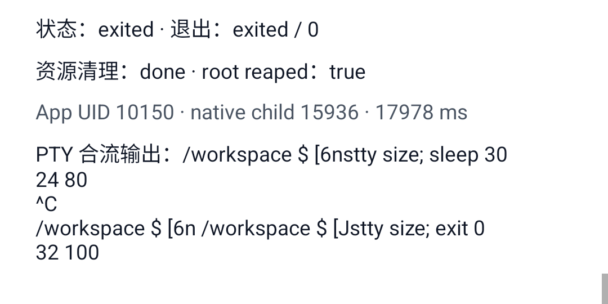

> **本机 PTY、产品终端与 120 秒资源验收已通过。** 任务专用 API 36 / ARM64 模拟器已执行实际 PTY 集成、6 项生命周期、App/tracer 死亡恢复、实际界面输入/resize/Ctrl-C/正常退出，以及固定 120 秒超时后的进程、PTY/wake/RUN FD 和 IO 线程清理。最终集成 CI 与发布继续收口；[Draft PR #13](https://github.com/kkkhs/pocketrun/pull/13) 提供源码基线。

[上一章](chapter-7.md)，我们让固定 Linux 脚本读取 CSV，等命令结束后收集输出。这适合一次性任务，但不能让用户在程序运行时继续输入。

这一章只增加一个能力：**启动固定的 Linux shell，在它运行时输入一句打印命令，看到新输出，再调整终端尺寸并结束会话。** 使用真正的 PTY，不把两个普通管道改名为“终端”。

操作时要检查的结果包括：

```text
终端已 ready，仍在运行
独立输出行：PocketRun PTY input OK
stty size：24 80（80 列、24 行）
运行中改为 100×32 后：32 100
正常 exit 0 后：退出码 0，资源清理 done
```

这是预期检查目标，不是本章已经运行成功的记录。设备上的终端名称和子进程 PID 动态分配，不要求等于某个示例值。

## 先在界面跑一遍

只在自己拥有或明确获授权的演示设备上操作。当前固定运行环境需要 **Android 14 / API 34 及以上、ARM64 App 的 64 位进程**；前章 Linux 安装和生命周期尚未完整验收，不能借它的一轮正常演示替本章通过。

打开“第 8 章 · 交互式 PTY”：

1. 先点“使用 80×24”，再点“启动交互终端”。等待 `PTY ready`；尚在准备 Linux 时，不发送输入。
2. 输入并发送下面的打印命令，确保文本末尾有一个真实换行，让 shell 收到完整的一行。
3. 在“PTY 实时合流输出”中找到**命令执行后独立的一行结果**，不是输入命令的回显。
4. 发送 `stty size`，检查 `24 80`；终端仍在运行时点“使用 100×32”，再次发送 `stty size`，应观察到 `32 100`。
5. 最后发送 `exit 0`，等待退出结果，再检查资源清理。不要把“发送成功”当作“程序已退出”。

```sh
printf 'PocketRun PTY input OK\n'
stty size
```

这里的 `stty size` 输出顺序是**行、列**，而界面尺寸显示是**列 × 行**。运行中 resize 返回成功后仍应再次查询，不能只信前端更新的数字。

2026-11-20 的实际 App 操作先得到 `24 80`，再用 Ctrl-C 中断正在执行的 `sleep 30`，运行中改到 100×32，重新查询得到 `32 100`，最后 `exit 0`。原生结果是 `exited / 0`、`root reaped=true`、`cleanupStatus=done`；不是终端尺寸按钮更新就算通过。



对应代码：`app/PtyPanel.tsx` 的 `start()`、`send()`、`resize()` 和 `beginPolling()`；`app/specs/NativePocketRunPty.ts` 声明五个入口：`startPty`、`writePty`、`getPtyOutput`、`resizePty`、`closePty`。

**启动方法的 Promise 在会话结束时才返回最终结果。** 页面通过另一个 `getPtyOutput()` 请求读取运行中的快照，不会等 `startPty()` 完成后才允许用户输入。

## 为什么这次需要 PTY

普通管道只传字节，不告诉程序“这里有一个终端”。shell、交互程序和终端控制需要知道尺寸、当前前台进程以及输入控制规则。

PTY 可以理解成一对软件终端端口：App 持有 master，子进程使用 slave 作为标准输入、标准输出和标准错误。用户输入从 master 写入；程序的输出再从 master 读回。

所以本章只有一份**合流输出**，不再承诺独立 stdout / stderr。它与前章分别收集两个输出通道是不同的数据路径，不是少展示了一个字段。

当前 React 页面只是文本输出预览，不是完整的终端模拟器。它没有承诺正确渲染所有光标移动、颜色和全屏编辑器控制序列；能交互读写 PTY，不等于已经完成完整终端产品。

## 谁持有终端，谁在执行

| 层或进程 | 做什么 | 身份与资源 |
| --- | --- | --- |
| React / TypeScript | 发送用户终端文字，读取快照，展示尺寸与退出结果 | 普通 App 进程中的 UI |
| App Kotlin | 校验 token、输入与尺寸，持有会话和临时目录 | 同一 App 进程、App UID |
| JNI / native | 创建 PTY、启动固定进程、读写 FD、调整尺寸、收集退出 | App 原生层；不提升 UID |
| PRoot 与 BusyBox shell | 使用终端，解释用户输入，运行 Linux 命令 | 普通 App UID 的子进程 |

本章不经过 UID 2000 的 Android shell 后端，也不通过电脑 ADB 发送用户终端输入。第 3—5 章的系统操作通道仍独立保留。

`writePty()` 的文字会由已启动的 shell 按终端输入解释，因此用户可以输入 shell 语法；这不是无人审批的工具协议，也不是新的安全沙箱。启动路径、环境、映射、PID 与 native 句柄仍由原生层固定选择，JavaScript 不能用输入参数替换它们。

下面的 Kotlin 文件位于 `app/android/app/src/main/java/io/github/kkkhs/pocketrun/`，native 实现在 `app/android/app/src/main/cpp/pocketrun_pty.cpp`。它们尚未形成公开的本章源码快照。

## 边运行，边读取新输出

`PtyModule.run()` 先验证 Linux 运行环境与工作目录，再取得本轮 RUN 目录、创建受控的 `PtyTrustedConfig`，调用 `PtySession.open()`。它启动的是固定的 PRoot / Alpine BusyBox shell，不是从 JS 接收可执行文件。

`PtySession.waitForExit()` 在等待退出前持续读取 PTY，并通过输出回调把新文字交给模块。这样程序不会因为 App 先阻塞等待退出、却没人消费满掉的终端缓冲区而卡住。

`PtyModule.getPtyOutput()` 返回当前 token 的输出快照、ready、尺寸与清理状态；页面按当前实现约每 400 ms 拉取一次。它是有界文本快照，不是模型流，也不是每个字节都有即时到达保证。

对应代码：`PtySession.waitForExit()`、`PtyCodec.consume()`、`PtyModule.getPtyOutput()` 和页面的 `beginPolling()`。取消、卸载或换代后，旧会话输出不能更新新会话。

<details>
<summary>原生启动、UTF-8 与输出预算</summary>

`PtyNative.nativeOpen()` 只接收 App 内部准备的路径和身份。native 创建 `/dev/ptmx` master / slave，为子进程建立终端会话并设置控制终端，连接标准 FD，再用固定参数启动 PRoot 和 `/bin/busybox sh -l`。PRoot、loader、BusyBox 与 musl 仍来自 APK 安装的只读文件，数据 rootfs 和工作目录来自 App 私有目录。

这个薄 JNI 层采用与 Termux 终端相同类型的系统机制，但“参考实现路径”不等于已经证明所有 Termux 行为或全部 Android / OEM 兼容性。native 的 exec 状态通道负责区分启动失败和正常退出，不能把 fork 成功当成 shell 已经可用。

单次输入按 UTF-8 限制为 4 KiB，每次 native 读取最多 8 KiB；会话展示输出按 UTF-8 总量限制为 64 KiB。`PtyCodec` 跨读取块保存未完整的字符，避免把分块的 UTF-8 当成损坏文字。

当前达到展示输出预算后会停止增加展示文字，仍需排空 native 输出以完成回收；接口没有单独的“全部输出完整”保证。不能把有限文本预览当作大输出任务的完整结果，也不能凭正文为它补造 `output_limit` 状态。

</details>

## 改尺寸，也检查控制字符

`resizePty()` 先检查当前会话仍 ready、未取消、未进入清理，再调用 `PtySession.resize()`。native 使用 `TIOCSWINSZ` 改变真实终端尺寸；这不是只改变 React 组件宽度。

界面提供 Ctrl-C 和 Ctrl-D：

- 测试 Ctrl-C 时，可以先在自有演示会话运行 `sleep 30`，再发送 Ctrl-C，观察当前命令是否被中断、shell 是否还能接受下一条输入。按钮返回不是信号效果的证明。
- Ctrl-D 是终端输入里的 EOF 控制语义，效果取决于当时输入状态；它不等同于销毁所有会话资源。需要明确结束时仍检查退出结果或点“关闭 PTY”。

对应代码：`PtyModule.writePty()` 把白名单控制名转成 `PtySession.Control`；`sendControl()` 写入对应字节。底层还有限定的信号入口，但 JS 不接受任意 PID 或信号数字。

<details>
<summary>resize、控制字符与固定超时的界限</summary>

列数和行数都必须是 16..400 的有限整数。native 的 `TIOCSWINSZ` 更新内核终端，并由内核通知前台进程组；不能凭前端尺寸状态断言程序已经处理了变化。

当前控制白名单还包含 form-feed、suspend、quit；页面仅展示 Ctrl-C / Ctrl-D，并不承诺所有控制字符组合已实测。向 PTY 写控制字节与通过 native 的限定信号方法作用于前台组是两条不同路径，测试不能互相替代。

当前 `PtyModule.DEFAULT_TIMEOUT_MS` 为 120000：从保留本次会话后计时，不因用户继续输入就重置。到期关闭输入并请求取消，结果状态为 `timed_out`，仍需单独检查资源清理。这个原生定时器不是依赖 UI 轮询才生效的超时，也不等于承诺所有清理在 120 秒瞬间完成。

这些 live / resize / timeout 方法按当前主树说明，最终源码和 APK 版本仍须在统一冻结时核对。未运行的真机场景不得由接口存在推断为通过。

</details>

## 退出后，不丢掉尚未清理的会话

正常发送 `exit 0` 后，页面应展示 `exited` 和退出码 `0`；取消、信号结束、超时或启动失败有各自结果。命令结束状态与 `cleanupStatus` 分开看。

`rootReaped` 只说明 native 直接持有的 tracer 子进程已被回收，不代表全部 guest / 后台子进程、线程和 FD 已在设备上证明消失。

`PtySession.cancel()` / `close()` 在 native 关闭未确认时保留会话所有权。`PtyModule.retryCleanup()` 继续核对 native 与本轮目录；如果结果为 `unproven`，页面保留 token、禁止新开终端，仅允许“重试 PTY 清理”。不能清掉 JS state 就把资源槽让给下一轮。

对应代码：`PtySession.waitForExit()`、`cancel()`、`close()`，以及 `PtyModule.closePty()` 和 `retryCleanup()`。已有 CSV 不因为退出终端而删除。

<details>
<summary>死亡与 FD 观察不能由调用次数替代</summary>

native 必须避免关闭与读写、退出观察与 PID 回收之间的竞态。实现用持久的启动/回收路径和有界关闭；保留尚未回收的 PID 身份，不能把 pid 已复用的进程当作自己的子进程再发送信号。

真实设备测试需分别观察正常退出、Ctrl-C、用户关闭、超时、App 死亡与 tracer / guest 死亡。检查直接子进程、后代树、PTY / wake / 状态 FD、读写线程和 RUN 目录，读取失败是未知，不是“已消失”。

`Chapter8PtyIntegrationTest` 已有可运行的 PTY 输入、尺寸、控制处理、退出与 FD / RUN 回收断言；存在测试源码或 JVM mock 通过不等于这些断言已经在云真机执行。异常场景还需补齐各自实际资源证据，不能用单项正常测试覆盖全部死亡路径。

</details>

## 当前验证边界

| 范围 | 本草稿状态 |
| --- | --- |
| Native spec、Panel、Module 与 PTY core | 当前主树可读，包含 live read、运行中 resize、控制、超时与清理保槽逻辑；最终版本待统一核对 |
| TypeScript / Jest / JVM / native 编译 | 用于检查接口和代码；本章不把已有开发机结果写成设备成功 |
| 真正 PTY 的输入、实时输出、resize 与控制效果 | API 36 / ARM64 实际 `Chapter8PtyIntegrationTest` 通过；不是模拟 PTY 或 JVM 假结果 |
| 退出、关闭、短期内部超时的 FD 与树回收 | 实际 `Chapter8LifecycleIntegrationTest`：`OK (6 tests)`；内部短期超时不代替产品 120 秒超时 |
| App / tracer 硬死亡恢复 | 两个 host-armed 场景实际通过；绑定 UID/PID/startTicks、精确发信号、观察旧树消失后再恢复，保留 CSV |
| 产品界面 | 实际打印、`24 80` → Ctrl-C → `32 100` → 正常退出 0；资源清理确认 |
| 产品 120 秒超时 | 2026-11-23：实际 `timed_out` / 120017ms，两个原 PRoot/guest 身份消失；FD 139 → 145 → 139，原 PTY master、wake pipe 和 RUN lease 全部消失，RUN 和 IO 线程库存回到基线 |
| 网站与公开发布 | 最终集成 CI、Pages、章节 tag 与源码 Release 继续推进 |

这批本机死亡恢复与第 7 章使用同一固定制品：Debug APK SHA256 `58b62dda2ffb74f413164c152cfb01cd3b5da07e92d17ab71bd8fe9fcfe98b76`，Test APK SHA256 `6b96dbb4742acc58a6a36fec139e8f51815d905a6488b8cb2f2144fbfd52754f`。早期 rootfs 库存/历史文件失败仍保留。另一次产品超时检查曾因 FD 150 → 151 失败，原运行没有改成通过；2026-11-23 的新运行记录完整 FD 目标，严格计数与资源归属检查同时通过。取消/超时路径可能没有退出快照，界面将该项显示为“未观测”；`cleanupStatus=done` 来自实际 native close 和 RUN 清理，不是把缺失快照改成成功。

<details>
<summary>源码门禁、设备测试与公开源码入口</summary>

最终版本需要执行 App TypeScript、ESLint、Jest、相关 JVM，ARM64 Debug / Release / AndroidTest 构建、audit、JNI / ELF / 16 KiB 对齐和许可证检查。自有或授权设备上需显式选择安装目标并核对系统、ABI、App / Test APK SHA，才运行 `Chapter8PtyIntegrationTest` 及各个死亡/清理专项。这里是待执行范围，不是已执行日志。

网站独立运行 `test:toolchain`、`typecheck`、`build`、`audit:ci`，并检查手机/桌面实际渲染。MDX 编译或类型检查不能证明 PTY 在 Android 上成功。

本地源码阅读从 `app/PtyPanel.tsx`、`app/specs/NativePocketRunPty.ts` 开始，再读前文 Kotlin 目录中的 `PtyModule.kt`、`PtySession.kt`、`PtyNative.kt`、`PtyCodec.kt`，最后对照 `app/android/app/src/main/cpp/pocketrun_pty.cpp` 和 `app/android/app/src/androidTest/java/io/github/kkkhs/pocketrun/Chapter8PtyIntegrationTest.kt`。

这些新增文件尚未形成已发布的 `chapter-8` tag。暂用明确的当前源码路径，不把未合并文件链接到不存在的 `main` 页面。实际发布后再登记真实 PR、固定快照与源码 Release，不提前给成功链接，也不公开调试签名 APK。

</details>

## 下一章把能力接成工具

本章把输入、输出、尺寸和结束状态接到一个真实 PTY 会话的实现中，但真机效果与完整生命周期仍待证明。它不是完整终端模拟器，也不是自动 Agent。

下一章再增加工具参数校验、手机端逐次审批与实际可运行的受控宿主。终端可输入文字不等于工具获得任意权限；宿主需要自己的校验、目标绑定、取消与结果核对，不能从本章直接跳到无人审批的模型循环。

练习：为什么 `writePty()` 返回成功、输出里出现输入回显、程序打印了独立结果、以及会话 FD 已关闭，是四条不同的证据？
