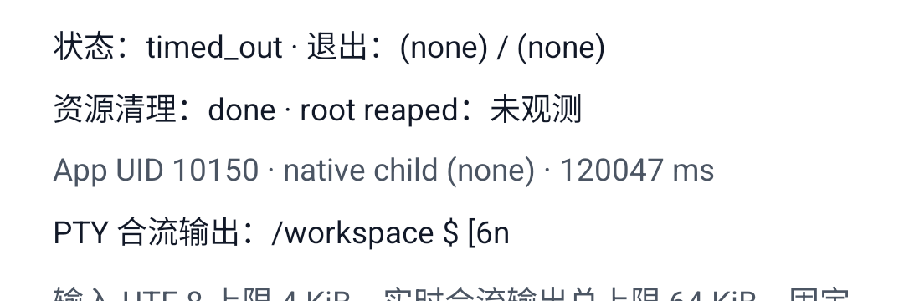

import ptyResultScreenshot from './assets/chapter-8-pty-result.png';
import PtyRoundtrip from './assets/pty-roundtrip.svg';
import figureStyles from '@site/src/css/tutorial-figures.module.css';

[上一章](chapter-7.md)，App 启动固定 Linux 脚本，等它结束，再拿到 CSV 行数。一次请求、一次结果，适合已经知道要做什么的命令任务。

现在换一种使用方式：**打开一个 Linux shell，先查看同一份 CSV，再输入数行命令；shell 不退出，你还可以继续输入。** 本章增加的是这段持续会话，而不是再装一份 Linux。

```text
启动终端 → 等 ready → 输入一行 → 看到输出
                       ↑          ↓
                       └─继续输入─┘
最后退出 → 获取最终结果 → 确认资源清理
```

终端里为什么可以一边显示结果、一边接收下一条输入？为什么 `startPty()` 尚未返回，React 的输入按钮却已经能用？我们沿这次会话把两件事讲清楚。

## 1. 先做一次交互式读文件练习

只在自己拥有或明确获授权的 **Android 14 / API 34 及以上、ARM64 的 64 位 App 进程**中练习，使用本 App 私有演示 CSV。

打开“第 8 章 · 交互式 PTY”：

1. 点“使用 80×24”，再点“启动交互终端”，等到 `PTY ready`。
2. 把输入框里的默认打印示例换成下面第一条命令。**在末尾输入一个真实换行**，再点“发送 PTY 文本”。
3. 观察文件内容，再发送第二条命令。未修改的初始 CSV 应得到独立结果行 `3`。
4. 不退出 shell，继续输入下一条命令。最后发送 `exit 0`，等待最终结果和清理状态。

```sh
/bin/busybox cat items.csv
/bin/busybox cat items.csv | /bin/busybox wc -l
```

第一次显示的应是第 6 章留下的文件内容：

```csv
name,quantity
apple,2
banana,3
```

这是基于现有固定 BusyBox shell 的**读文件练习**。既有设备验收实跑的是默认 `printf`、尺寸查询、Ctrl-C 与退出流程，下面的真实截图来自那条记录；本文没有把新增的 CSV 交互步骤记为已经取得的新设备验收。

<figure style={{margin: '1.25rem 0', maxWidth: 400}}>
  
  <figcaption>已实跑的尺寸查询、Ctrl-C 和退出流程；不是新增 CSV 练习的验收截图。</figcaption>
</figure>

截图记录的是 2026-11-23 独立章节包：`stty size` 得到 `24 80`，Ctrl-C 中断 `sleep 30`，调整尺寸后查询到 `32 100`，最后 `exit 0`；结果是 `exited / 0`、`root reaped=true`、`cleanupStatus=done`，14974ms 后结束。

**输入回显不是执行结果。** 终端可能先显示你写进去的命令；要等它后面真正打印文件内容或独立的 `3`，不能看到 `wc -l` 出现在输出里就认为数行完成。

## 2. 谁执行：React、Kotlin 与真实终端两端

| 负责者 | 这次会话中做什么 | 进程与身份 |
| --- | --- | --- |
| React / TypeScript | 输入框、发送按钮、持续显示输出 | 普通 App 进程 |
| App Kotlin | 绑定会话、校验输入、保存输出快照、处理关闭 | 同一个 App 进程、App UID |
| JNI / native | 创建 PTY、读写文件描述符、启动固定程序和回收子进程 | App 原生层，不提升 UID |
| PRoot / BusyBox shell 及命令 | 接收终端输入、解释命令、继续等待下一行 | 普通 App UID 下的子进程 |

本章没有通过第 3—5 章的 Binder 后端执行命令，也不让电脑 ADB 搬运终端输入。

前两章的管道只传字节；交互程序还要知道“这里是终端”、当前尺寸、输入规则和前台进程组。PTY 是一对软件终端端口：**App 持有 master，shell 使用 slave 作为标准输入、标准输出与标准错误。**

<figure style={{margin: '1.25rem 0', maxWidth: 560}}>
  <PtyRoundtrip className={`pr-pty-roundtrip-diagram ${figureStyles.diagram}`} role="img" aria-labelledby="pr-pty-roundtrip-title" aria-describedby="pr-pty-roundtrip-desc" style={{display: 'block', width: '100%', height: 'auto'}} />
  <figcaption>箭头表示运行中的输入与输出往返；一次会话可以往返多次，不是每条命令都重新创建 PTY。</figcaption>
</figure>

stdout 和 stderr 都连到同一个 slave，所以 App 从 master 读到一份**合流输出**。这和前两章分别收集 stdout/stderr 不同，不是漏掉了错误字段。

## 3. 启动终端：Promise 等结束，页面先开始观察

平常写 React 请求时，可能会用 `await` 等结果后再更新 state。但交互终端不能等 shell 退出以后才启用输入。

[PtyPanel.start()](https://github.com/kkkhs/pocketrun/blob/chapter-8/app/PtyPanel.tsx#L82-L92) 先启动轮询，再等待最终结果：

```ts
beginPolling(token, current);
const next = await NativePocketRunPty.startPty(token, initialSize.columns, initialSize.rows);
```

**这个 `await` 等的是整个会话结束，不是“shell 启动好了”。** async 函数暂停不等于 React 事件处理被阻塞；轮询和发送按钮仍可以调用其他原生方法。

Kotlin 的 [PtyModule.run()](https://github.com/kkkhs/pocketrun/blob/chapter-8/app/android/app/src/main/java/io/github/kkkhs/pocketrun/PtyModule.kt#L234-L277) 先复用第 7 章的固定环境和原工作目录，再创建本轮临时目录与 `PtyTrustedConfig`，交给 native 启动：

```kotlin
val operation = terminal.open(owned.token, config, owned::append)
synchronized(lock) { owned.operation = operation }
terminal.resize(operation, owned.columns, owned.rows)
```

这里的 `config` 是 App 内部准备的固定路径、UID 和父进程信息，不是 React 提交的命令配置。native 建立终端后，模块把当前会话标记为 ready，页面才启用输入。

固定 shell 的工作目录仍是 `/workspace`，绑定到第 6 章的真实 `workspaces/demo`。因此 `items.csv` 不需要经过输入框上传，也不需要从输出预览里重建。

## 4. 输入一行：文字怎样到达 shell

点“发送 PTY 文本”后，[PtyPanel.send()](https://github.com/kkkhs/pocketrun/blob/chapter-8/app/PtyPanel.tsx#L109-L116) 调用：

```ts
try { await NativePocketRunPty.writePty(token, text, control); }
catch (failure) { setError(failure instanceof Error ? failure.message : 'PTY 输入失败。'); }
finally { setSending(false); }
```

`token` 指定正在运行的这一份会话；`text` 是你输入的文字，普通文本时 `control` 为空。原生层检查 token 仍有效、会话可写，以及 UTF-8 字节数没有超过 4 KiB。

在 [PtySession.write()](https://github.com/kkkhs/pocketrun/blob/chapter-8/app/android/app/src/main/java/io/github/kkkhs/pocketrun/PtySession.kt#L75-L79) 中，文字最终成为写给 PTY master 的字节：

```kotlin
val slot = requireActive(operation)
return backend.write(slot.handle, bytes.copyOf())
```

这些字节通过 slave 到达 shell 的标准输入。正常终端行输入模式下，shell 需要收到换行才把这一行作为命令处理，所以输入框里看见文字、甚至按钮返回成功，都不代表 shell 已经执行。

与第 7 章不同，**本章文字由已启动的 shell 解释**：读者可以在自己的演示终端输入管道语法。这是用户直接操作终端，不是无人审批的模型工具入口。启动程序、环境、映射与 native 句柄仍固定；JS 不能指定 PID 或把会话切到别的可执行文件。

## 5. 看新输出：运行结果通过另一条请求回到页面

shell 执行 `cat` 或 `wc` 后，输出写进 slave；App 从 master 读出字节，Kotlin 把它追加到当前会话的输出缓存。

[PtySession.waitForExit()](https://github.com/kkkhs/pocketrun/blob/chapter-8/app/android/app/src/main/java/io/github/kkkhs/pocketrun/PtySession.kt#L107-L112) 在等待最终退出之前持续读取：

```kotlin
while (true) {
    val bytes = backend.read(slot.handle, PtyCodec.MAX_READ_BYTES) ?: break
    emitIfCurrent(slot, slot.codec.consume(bytes).text)
}
```

`PtyCodec` 处理跨读取块的 UTF-8 字符。只等进程结束而不读输出，会有缓冲区塞满、子进程等 App 读取、App 又等子进程退出的风险。

React 取得运行中输出用的是另一个入口：[beginPolling()](https://github.com/kkkhs/pocketrun/blob/chapter-8/app/PtyPanel.tsx#L49-L64)。

```ts
const snapshot: PtySnapshot = await NativePocketRunPty.getPtyOutput(token);
if (current !== generation.current || activeToken.current !== token || snapshot.token !== token) { return; }
setLiveOutput(snapshot.output);
setReady(snapshot.ready);
setSize({ columns: snapshot.columns, rows: snapshot.rows });
```

每次得到的是**当前累计文本快照**，不是“自上次以来的增量”。因此这里直接 `setLiveOutput(snapshot.output)`，不再把它追加一次，否则页面会出现重复输出。当前实现约 400ms 再读一次，并检查 token 与页面代际，旧会话不能更新新会话。

现在可以把两个异步结果分开：

| 请求 | 返回什么 | 什么时候用 |
| --- | --- | --- |
| `getPtyOutput(token)` | ready、累计输出、尺寸、清理是否待处理 | shell 仍在运行时反复观察 |
| `startPty(...)` 的 Promise | 最终退出状态、完整的有界预览与清理结果 | 会话结束后核对 |

## 6. 继续操作：尺寸和 Ctrl-C 作用于同一终端

读完 CSV 后，不用重启 shell，就可以发送 `stty size`。先选择 80×24，输出应是 `24 80`；在运行中点“使用 100×32”，再查询应是 `32 100`。`stty` 的顺序是**行、列**，UI 写的是**列 × 行**。

[PtyPanel.resize()](https://github.com/kkkhs/pocketrun/blob/chapter-8/app/PtyPanel.tsx#L125-L127) 把新尺寸交给原生层：

```ts
await NativePocketRunPty.resizePty(token, columns, rows);
if (activeToken.current === token) { setSize({ columns, rows }); }
```

native 用 `TIOCSWINSZ` 修改内核终端尺寸，不是只改 React 组件宽度。按钮返回后再执行 `stty size`，才观察到程序侧的实际尺寸。

同一个 shell 里运行 `sleep 30`，再点“发送 Ctrl-C”。UI 发送的是限定的 `interrupt` 控制名，Kotlin 通过 [sendControl()](https://github.com/kkkhs/pocketrun/blob/chapter-8/app/android/app/src/main/java/io/github/kkkhs/pocketrun/PtySession.kt#L82) 写入控制字节：

```kotlin
fun sendControl(operation: Operation, control: Control): Int = write(operation, byteArrayOf(control.byte))
```

正常终端设置下，Ctrl-C 的字节由终端驱动解释，向前台进程组发中断；它不是往屏幕里打印两个字符，也不是关闭整个 PocketRun。观察当前命令结束、shell 还能接受下一行，才证明这种交互效果。

Ctrl-D 是终端输入的 EOF 控制语义，效果取决于当时输入状态，不等于一键销毁所有会话资源。明确结束这次练习时仍使用 `exit 0` 或“关闭 PTY”，再检查最终状态。

## 7. 退出会话：不要只清空 React 页面

发送 `exit 0` 后，shell 退出，原生层结束读写并回收进程；这时最初的 `startPty()` Promise 才返回。页面显示 `exited / 0`，再检查 `cleanupStatus=done`。

命令退出与资源清理是两个结果。`rootReaped` 表示 native 直接持有的 tracer 子进程已回收，不独立证明全部后代、线程与 FD 都消失。取消或超时还可能没有发布退出快照，UI 将它显示为“未观测”，不把默认 false 当作实际回收失败或补写 true。

如果清理为 `unproven`，模块保留 token 和资源槽，只允许“重试 PTY 清理”；不能先清空 state、开下一份终端，把旧资源忘掉。原 CSV 与完整安装保留，不随着终端退出删除。

当前终端有固定 120 秒期限，不因继续输入而重置。达到期限会显示 `timed_out` 并开始收尾；“正好到 120 秒”不等于承诺所有清理在那个瞬间完成。

## 8. 实践与下一章

完成章首练习后，检查四件事：输入的一行有没有换行、看到的是回显还是结果、shell 能否继续输入、退出后资源是否确认清理。

再思考：如果 `startPty()` 还没返回，为什么页面已经能显示 `3`？如果把每次快照都追加到旧 state，为什么会重复显示？

这里的 React 页面是有界文本预览，**不是完整终端模拟器**；颜色、光标移动、全屏编辑器等控制序列不承诺完整渲染。接通 PTY 不等于做完终端产品。

[下一章](chapter-9.md)不把这个自由终端直接交给模型，而是把已有能力收束为固定工具：申请一次动作、等待手机批准、执行并核对结果。终端能接收 shell 语法，不意味着工具获得任意权限。

<details>
<summary>深入：native 怎样创建终端，怎样处理字节预算</summary>

固定实现见 [pocketrun_pty.cpp](https://github.com/kkkhs/pocketrun/blob/chapter-8/app/android/app/src/main/cpp/pocketrun_pty.cpp)。native 打开 `/dev/ptmx` master/slave，为子进程建立 `setsid` 会话与 `TIOCSCTTY` 控制终端，把 slave 连接到 stdin/stdout/stderr，再以固定参数启动 PRoot 和 `/bin/busybox sh -l`。工作目录 `/workspace`、rootfs、BusyBox/musl 绑定与环境来自 `PtyTrustedConfig`；`HISTFILE=` 固定关闭持久历史，不修改已校验 rootfs。

这是与 Termux 同类的系统机制，不等于证明全部 Termux 行为或 Android/OEM 兼容性。exec 状态通道区分启动失败与正常退出，fork 成功不代表 shell 已 ready。

单次输入 UTF-8 上限 4 KiB，native 单次读取最多 8 KiB，累计展示文字最多 64 KiB。`PtyCodec` 保存块尾未完整字符；达到展示预算后不再增加预览，但仍排空输出以完成回收。当前接口不提供独立的“全部输出完整”保证，不能为它补造 `output_limit` 状态或把预览当成大输出的无损结果。

尺寸为 16..400 的有限整数。`TIOCSWINSZ` 更新内核并通知前台组，不证明程序已经处理通知。控制白名单还包含 form-feed、suspend、quit，页面仅展示 Ctrl-C/Ctrl-D；限定信号方法与写控制字节是不同路径，不以一项测试替代全部控制效果。

</details>

<details>
<summary>深入：关闭、期限与资源所有权</summary>

`PtySession.cancel()/close()` 在 native 关闭未确认时保留所有权。`PtyModule.retryCleanup()` 重试本轮 native 句柄与 RUN 目录；未知 procfs、目录引用、读取错误和观察超时不是“消失”。已有工作文件不因关闭而删除。

`PtyModule.DEFAULT_TIMEOUT_MS=120000` 从保留本次会话开始计时，独立于 UI 轮询。到期关闭输入并请求取消，最终状态与清理分别检查，不宣称严格瞬间回收。

native 持久启动/回收路径处理关闭与读写、退出与 PID 回收的竞态；不能对已复用 PID 发信号。设备检查分别观察正常退出、Ctrl-C、关闭、超时、App 与 tracer/guest 死亡，并核对 PTY/wake/状态 FD、线程、后代与 RUN。一次 `close()` 调用不代替资源观察。

</details>

<details>
<summary>验收记录：实际交互、生命周期与产品 120 秒期限</summary>

| 范围 | 已记录结果 |
| --- | --- |
| 真正 PTY 输入、输出、resize 与控制 | API36/ARM64 `Chapter8PtyIntegrationTest` 通过，不是模拟 PTY |
| 退出、关闭、短期内部超时、FD 与 RUN | `Chapter8LifecycleIntegrationTest`：`OK (6 tests)`；短期超时不代替产品期限 |
| App/tracer 硬死亡恢复 | 两个 host-armed 场景通过；按 UID/PID/startTicks 绑定旧身份并核对消失，保留 CSV |
| 实际产品界面 | `24 80` → Ctrl-C 中断 `sleep 30` → `32 100` → `exit 0`，正常清理 |
| 新增 CSV 交互练习 | 基于固定 BusyBox shell 的阅读练习；本次文章改写未重新取得这组命令的设备验收 |

本机早期固定制品：Debug APK SHA256 `58b62dda2ffb74f413164c152cfb01cd3b5da07e92d17ab71bd8fe9fcfe98b76`，Test `6b96dbb4742acc58a6a36fec139e8f51815d905a6488b8cb2f2144fbfd52754f`。rootfs 库存/历史文件原失败保留。另一次产品超时曾因 FD 150→151 失败，未改写为通过。

2026-11-23 的新产品运行得到 `timed_out / 120017ms`，原两个 PRoot/guest 身份消失；FD 139→145→139，原 PTY master、wake pipe、RUN lease 消失，RUN/IO 库存还原。取消/超时可能缺少退出快照，显示“未观测”；清理确认来自实际 native close 与 RUN 检查。

合入第 7 章发布源后的独立第 8 章 Debug APK SHA256 `bf34565809a4524c0adc41888750908fca9743d81fd86dd6cfc9bd8bb814a39b`，Test `ae018b6f9e5a7bbe78734dd224009a7279c04bdd347cd82b4c082db651ea50d3`，再次通过 PTY、6 项生命周期、两项死亡恢复与章首实际界面流程。

独立包又实跑原 120000ms 期限。总 FD 143→147 的原断言保留为失败；完整目标表中差额全为 Android 图形 `anon_inode:sync_file`（19→23）。另一个精确自有资源检查保持每个非图形 FD 目标/计数严格一致，要求 master、wake、RUN lease、原进程消失、RUN/IO 还原。新运行总 FD 147→148，仅图形 fence 23→24，非图形库存与自有资源检查通过；这不把原总数失败改成通过。



原生测试、产品 UI 与资源专项各有范围，不拼成一轮全设备兼容结论。

</details>

<details>
<summary>实践：构建、设备检查与源码阅读入口</summary>

按[第 1 章](chapter-1.md)准备工具链，执行 App 的 typecheck、lint、Jest、audit；Android 执行相关 JVM 和 ARM64 Debug/Release/AndroidTest 构建，参数 `-PreactNativeArchitectures=arm64-v8a --max-workers=2`。对应 JNI/ELF/16 KiB 对齐与许可证也按实际制品核对。

设备检查只在自有或授权演示设备上进行，每条 ADB 显式选 serial，安装前核对系统、ABI、App/Test APK SHA。`Chapter8PtyIntegrationTest` 与死亡/清理专项分别运行；有宿主协议的死亡测试不能作为普通无驱动测试直接执行。App 安装、JVM mock、页面截图或 MDX 构建不能替代 Android PTY 效果。

阅读从 [PtyPanel.tsx](https://github.com/kkkhs/pocketrun/blob/chapter-8/app/PtyPanel.tsx) 与 [NativePocketRunPty.ts](https://github.com/kkkhs/pocketrun/blob/chapter-8/app/specs/NativePocketRunPty.ts) 开始，按本次动作进入 `PtyModule`、`PtySession`、`PtyNative`、`PtyCodec`；这些 Kotlin 文件都位于 `app/android/app/src/main/java/io/github/kkkhs/pocketrun/`。最后对照 native 与 `Chapter8PtyIntegrationTest`。

网站独立运行 test:toolchain、typecheck、build、audit:ci，并检查手机/桌面深浅主题、折叠内容和链接。不同源码与 APK 分别核对，不让旧结果自动证明新包。

</details>

## 本章源码

本文代码摘录固定对照已发布 `chapter-8`。本章原实际验收、main CI、Pages 与公开源码交付均已完成；新阅读练习保持上文注明的范围。

- [PR #13：交互式 PTY 与资源回收](https://github.com/kkkhs/pocketrun/pull/13)
- [PR #22：任务主线、原位代码与图解](https://github.com/kkkhs/pocketrun/pull/22)
- [chapter-8 源码 Release](https://github.com/kkkhs/pocketrun/releases/tag/chapter-8)：完整源码、对应第三方来源和 SHA256 校验，不发布调试签名 APK。
