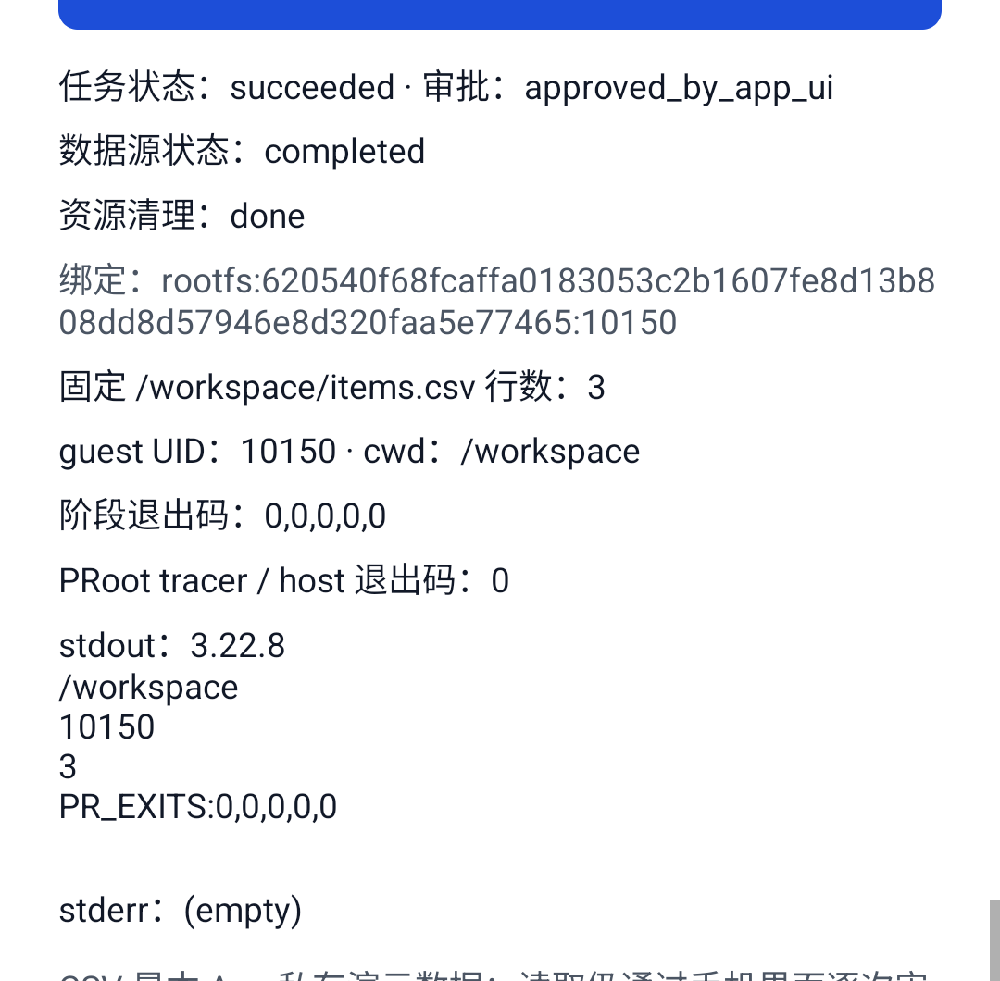
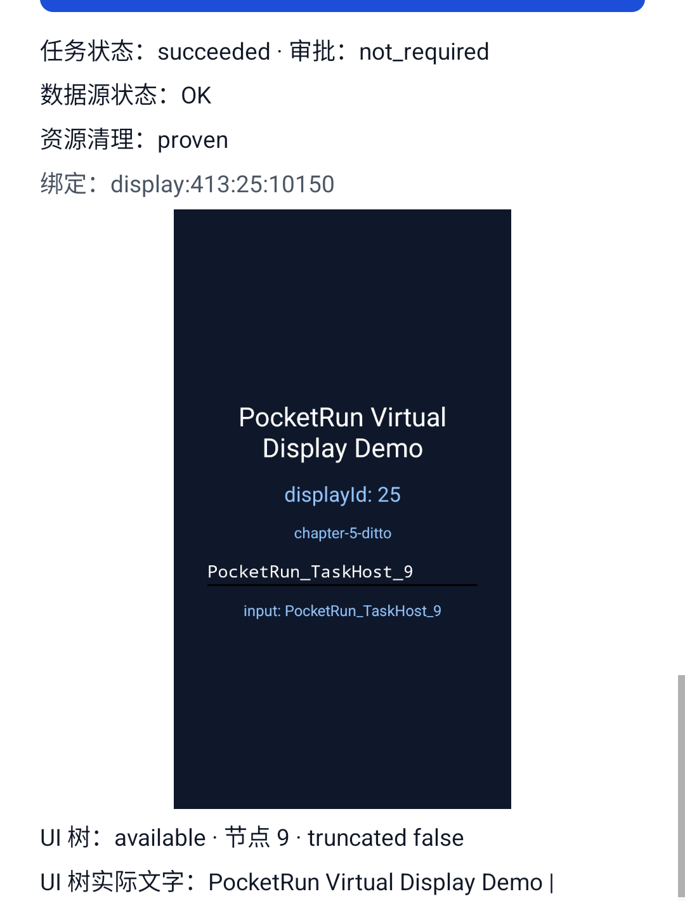
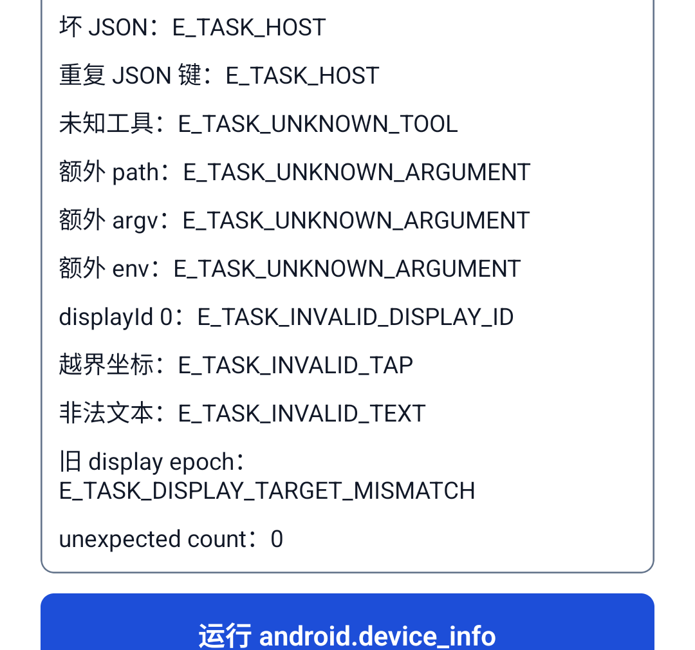

> **本章已发布。** [PR #14](https://github.com/kkkhs/pocketrun/pull/14)、main CI/Pages 与 [chapter-9 源码快照](https://github.com/kkkhs/pocketrun/releases/tag/chapter-9)均已完成。独立章节 App 验证了实际工具、手机逐次审批、来源与资源边界，包含真正执行中取消、原五秒期限和固定坏参数的 JS 桥拒绝。

[上一章](chapter-8.md)，我们接上了交互式 PTY 的实现。前面几章已经分别给出了设备信息、目标虚拟屏、工作文件和 Linux 命令通道。

这一章不接模型，而是先完成一个可核对的小任务：**在手机上申请读取固定演示 CSV 的行数，查看它绑定的目标，同意这一次请求，再检查真实 Linux 输出和资源清理。** 随后拒绝另一次相同请求，确认它没有执行。

宿主是实际运行在 **App Kotlin** 中的确定性程序：只接受三个固定工具，安排校验、审批、执行与结束。它不是 Node 进程，不把 RN 的 JS 运行时当作 Node，也不增加 MCP、多任务框架或真实模型循环。

## 先在手机上跑一遍

只使用自己拥有或明确获授权的设备与本 App 私有演示 CSV。Linux 工具沿用第 7 章的 Android 14 / API 34、ARM64 64 位 App 条件，以及固定的最小 BusyBox / musl 环境；本章继续独立核对工具审批与执行的生命周期，不用前章结果替代。

打开“第 9 章 · 确定性工具宿主与手机审批”：

1. 点“准备固定 Linux 工具”。应看到当前 App UID、已校验的 Linux 安装 generation。
2. 点“运行 android.device_info”。它不需要审批；结果应来自当前 App 的 Android 版本、API 与包身份，不是测试写死的字段。
3. 点“申请读取固定演示 CSV 行数”。应进入 `pending_approval`，显示工具名、`/workspace/items.csv`、安装版本、App UID、request hash 与固定手机 App UI 审批角色。
4. **在手机的当前请求面板**点“同意当前请求”。等待执行结果；未修改的初始 CSV 应得到行数 `3`、真实 App UID、cwd `/workspace`，以及成功的命令与清理状态。
5. 再申请一次，点“拒绝当前请求”。应得到 `rejected`，不能启动这一轮 Linux 读取。
6. 再申请一次，可点“取消当前请求”；也可等待当前审批过期，再点“刷新过期状态”核对 `expired`。旧请求的同意不能授权下一次请求。

这次独立第 9 章正常 App 的实际结果是 `succeeded / approved_by_app_ui`：固定 CSV 为 3 行，App/guest UID 10150、cwd `/workspace`、五阶段和 PRoot 退出码均为 0，来源完成且清理为 `done`。

准备 Linux 本身会校验或安装固定环境。拒绝读取的意思是“不执行这次读取工具”，不是声称之前的准备从未触碰文件系统。

有清理警告时只点“重试资源清理”，不能开始另一个工具来掩盖旧资源。工具失败仍应保留实际输出、退出码与错误，不把有输出或清理恢复当作工具成功。

对应代码：`app/TaskHostPanel.tsx` 的 `submit()` 选择固定工具，`perform()` 调用原生接口；审批按钮调用 `decideFromAppUi()`，取消调用 `cancelFromAppUi()`。`app/specs/NativePocketRunTaskHost.ts` 中本章使用八个入口：准备、读取就绪状态、提交、读取任务状态、手机决策、手机取消、刷新与清理重试。

实际显示工具先返回同一个 `displayId` 的截图与 9 个 UI 节点。手机批准固定文字后，输入事件被接收；再点观察，截图和 UI 树同时显示 `PocketRun_TaskHost_9`。输入成功与目标界面实际改变是两次检查。

## 工具请求不是任意命令

宿主只识别这三个工具名：

| 工具 | 做什么 | 本章审批规则 |
| --- | --- | --- |
| `android.device_info` | 读取当前 App 可用的设备与包信息 | 不需要审批 |
| `linux.count_demo_csv` | 读取固定私有 CSV 的行数 | 每次需要手机 App UI 同意 |
| `android.virtual_display_observe_or_demo_input` | 观察当前演示虚拟屏，或执行受限演示输入 | 观察不审批；输入需要审批，且目标后端必须就绪 |

CSV 工具参数是 `{}`。路径由原生层固定为 `/workspace/items.csv`，调用者不能传文件名、命令、argv、环境、绑定目录或可执行文件，也不能在参数中加 `approved: true` 跳过审批。

对应代码：`taskhost/ToolContract.kt` 中的 `PocketRunTool`、`ToolSchema.validate()`；`TaskHostModule.submitTool()` 严格解析 JSON 后交给 `TaskHost.submit()`。未知工具、额外或缺失字段、错误类型、超预算输入都拒绝，不用 TypeScript 类型替代运行时检查。

**工具名只描述动作，不授予权限。** 本章采用固定的小调用面，先证明它的边界，不为未来模型预留任意 shell 或动态工具注册接口。

下文 `TaskHostModule.kt` 位于 `app/android/app/src/main/java/io/github/kkkhs/pocketrun/`；`taskhost/` 文件位于该目录下的同名子目录。当前是本地源码路径，尚无已发布的第 9 章快照链接。

## 谁执行，谁负责审批

| 层或通道 | 负责什么 | 实际身份 |
| --- | --- | --- |
| React / TypeScript 手机 UI | 展示请求、同意/拒绝/取消、观察状态 | 普通 App 进程 |
| App Kotlin 宿主 | 校验、绑定目标、维护本次审批与资源所有权 | 同一 App 进程、App UID |
| Linux 适配器与 PRoot / BusyBox | 真实读取固定 CSV，返回输出与退出码 | 普通 App UID 的子进程 |
| App 自有 typed Binder → shell 后端 | 仅承接就绪目标虚拟屏的观察/演示输入 | 独立 UID 2000 后端；不承接 Linux 工具 |

审批在产品里的手机 App UI 发生。开发流程允许自主决策，不等于产品可以自动同意用户请求；电脑端不能冒充手机端点击来代批敏感操作。

宿主没有模型客户端。它根据明确的工具、参数和固定规则决定是否等待审批、能否执行以及如何结束，不会自行想出新命令。

## 把审批绑定到这一条请求

同一工具可以申请多次，但每次都有新的 `requestNonce`。它用来确认“你正在同意哪一条请求”，不是长期有效的授权。

`TaskHost.submit()` 校验后快照目标，再把工具、参数、App UID、rootfs / display 版本与路径纳入 request hash。手机面板展示这些绑定；`onAppUiDecision()` 只接受当前待审批、nonce 相同、尚未消费的请求。

同意后还要重新检查目标。安装换代、虚拟屏销毁、后端死亡、请求过期或取消后，不能拿旧同意继续执行；有句柄也不等于有权限。

对应代码：`TaskHost.requestHash()`、`bind()`、`onAppUiDecision()`、`preStartInvalidation()` 与 `targetMismatch()`。拒绝、取消和失效分别保留自己的状态，不统一写成“没有结果”。

审批绑定的是固定工具与目标，不是把当时 CSV 内容冻结成不可变快照。运行时仍须检查实际文件和结果，不能把批准路径解释成批准任意文件或预先保证行数永远为 `3`。

nonce、期限与状态如何对应

原生核心生成安全随机 nonce，并加入请求序号，避免重复 nonce 来源意外授权后续请求。request hash 使用明确字段和长度编码，包括当前绑定，调用者不能传 actor 或自动确认标记。

当前默认审批期限为 30 秒，执行期限为 5 秒，使用单调时间。`refresh()`、`state()` 与执行前/完成时重新检查期限；手机页面轮询状态并提供“刷新过期状态”。这不是已经完成的持久后台调度器，不能把墙上时钟、UI 按钮禁用或一个编译成功的定时检查当作真机超时验收。

任务阶段包括 `pending_approval`、`executing`、`succeeded`、`failed`、`rejected`、`cancelled`、`expired`、`invalidated` 与 `invalid_input` 等。审批状态另行标记是否无需审批、手机同意/拒绝、取消、过期或失效；它不替代执行结果。

原生 `decideFromAppUi()` 仅接受 `approve` 或 `reject`，并消费当前 nonce。它是手机 UI 的约定入口，不是对外提供可自动代批的宿主接口；本章不宣称已经建立硬件级可信 UI 或远程审批机制。

## 同意之后，真正调用 Linux 能力

`AndroidTaskCapabilities.prepareLinuxEnvironment()` 使用第 7 章的真实 `LinuxSession`、固定清单和 App 私有工作目录。准备完成才形成 `LinuxTarget`，包含 App UID、安装 generation 与规范化工作目录。

`prepareCountDemoCsv()` 再核对目标与固定文件，创建本次 `OwnedExecution`。宿主先持有它，再调用 `start()`，避免“动作已经开始，但还没有资源所有者”的窗口。

实际读取仍执行 `LinuxSession.runDemo()`：先检查版本、cwd 和 UID，再用 BusyBox 的 `cat` / `wc` 得到行数。工具结果不是 JVM 计算的假数字，也不是电脑 ADB 替 App 执行的 shell 命令。

`AndroidTaskCapabilities.linuxOutcome()` 保留 stdout、stderr、外层与内部退出码、运行身份、目录、行数及清理状态。只有真实来源满足成功约定时才返回成功；来源失败或清理未知时，失败结果也带上已取得的输出。

对应代码：`taskhost/AndroidTaskCapabilities.kt` 的 `prepareCountDemoCsv()`、`startLinux()`、`linuxOutcome()`；宿主的 `launch()` 与 `finish()` 负责最后一次目标/期限检查及资源收口。

固定路径与失败输出的边界

`CanonicalChildPath.existingRegularFile()` 要求工作目录已经 canonical，子路径不能绝对化或包含逃逸段，目录链上不能有符号链接，目标必须是真实普通文件。CSV 工具没有对外路径参数，仍在准备与执行时复查固定文件。

原生 JSON 解析、工具 schema、能力快照和适配器是四个不同检查点。不能因为 JSON 语法正确就运行，也不能因为审批通过就跳过安装版本或显示目标重检。

Linux 来源的 `cleanupStatus` 使用 `done / unproven`；宿主自身的 `cleanupState` 使用 `none / pending / proven / unproven`。界面同时区分数据源状态、任务状态与清理状态，不把它们当一个布尔值。

`ExecutionOutcome.Failure` 可以携带真实 `ToolResult`。它用于保留诊断，不意味着失败已经变成成功；迟到结果、目标改变与资源清理失败都不能被一个 stdout 字符串覆盖。

## 虚拟屏未就绪时，明确停止

虚拟屏工具要求正数 `expectedDisplayId` 和当前 `expectedDisplayEpoch`。显示编号相同但会话版本不同，也不能复用旧审批。

当前 Android 适配器通过 `TaskHostDisplayPortRegistry` 取得 **App 自有 typed-Binder** 的显示端口。未接入并就绪时，界面显示“不可用（明确拒绝，不回退默认屏）”，相关按钮禁用；原生提交也必须得到 `BACKEND_NOT_READY` 等明确错误。

这不否定前章已发布 AVD 的显示结果，但也不能把那些旧结果当作本章显示宿主已接好。Dora 主机 ADB 已连接，不等于 PocketRun 已完成本机配对、启动后端或建立了本章可用的端口。

对应代码：`TaskHostPanel.displayArguments()`、`ToolSchema.parseDisplay()`、`TaskHost.bind()` 和 `AndroidTaskCapabilities.currentDisplayTarget()`。不能回退显示 `0`，不能把主机连接伪装成 App 内授权，也不能在后端缺失时返回伪造的截图或成功输入。

观察与输入都必须保持目标显示。即使演示输入调用返回成功，仍需像第 5 章那样重新观察控件与画面，核对目标实际改变；这条真机路径当前待完成。

## 取消和清理，也属于宿主任务

宿主一次只持有一个请求。取消、过期、后端死亡或关闭时，它让当前 `OwnedExecution.close()` 停止本次原生/进程/Binder 工作，而不只是清空页面。

关闭失败时保留 owner 和资源槽，状态为 `failed`、清理为 `unproven`，拒绝新工具。`retryCleanup()` 只对这份仍被持有的资源重试，不用新请求覆盖旧状态。

**重试清理成功，不改写原任务为成功。** `cleanupAndCommit()` 在曾经清理失败后保留 `failed` / `CLEANUP_RECOVERED`，只把清理标为已确认。它与“这次工具从头到尾成功”是不同结论。

对应代码：`TaskHost.terminateLocked()`、`cleanupAndCommit()`、`retryCleanup()` 与适配器各自的 `close()`。后端死亡回调必须同时匹配请求 nonce 与绑定 epoch，不能让旧后端事件取消新任务。

## 当前验证边界

| 范围 | 本草稿状态 |
| --- | --- |
| 三工具约定、手机 UI 八个入口、原生宿主与真实适配器 | 当前源码可读，新增集成待最终冻结和统一门禁 |
| 真实设备信息、固定 Linux CSV、手机同意/拒绝/取消/过期 | 实际 App 已验证；CSV 为 3 行、App/guest UID 10150、`/workspace`、五阶段退出码 0、来源完成与清理确认 |
| 目标显示与输入 | 实际 App 自有 TLS ADB → UID 2000 Binder → display 25 / epoch 413；观察返回 9 节点和真实截图，手机批准固定文字后重新观察确认相同目标上的 `PocketRun_TaskHost_9` |
| 待批准时后端死亡 | 精确核对 UID/PID/startTicks 后终止自有后端；当前请求实际变为 `invalidated / BACKEND_DEATH`，没有把旧批准移到新目标 |
| 执行中取消与五秒期限 | 手机批准后已启动的自有 PRoot 由测试夹具暂停；实际取消返回 `USER_CANCELLED`，原五秒执行期限返回 `EXECUTION_TIMEOUT`，两者资源清理为 `proven` |
| 关闭失败、迟到回调与换代 | 核心回归与最终组合矩阵分别核对，旧结果不能覆盖新请求 |
| 网站与公开交付 | **页面草稿渲染不等于产品已通过；PR / Pages / tag / Release 尚待完成** |

2026-11-23，独立第 9 章 Debug APK SHA256 `911c97addec0e0bfaa5cadf00e7f8813df20d56b4934119efb6e95e931245b0e`、Test APK SHA256 `e3bb6922c041cc8f1bfd9fdb78250b7e3d89ae9ad7efa990118bf67e344d3c3f` 实际执行了 `Chapter9TaskHostIntegrationTest` 的 4 项原生检查，全部通过；真实手机批准 CSV、执行中取消和原五秒期限另有独立实际 UI 与进程/RUN 证据。

生产界面自配对 → TLS UID 2000 → Binder → 虚拟屏路由的 `ProductAdbBootstrapIntegrationTest` 也已通过（114.549s）。配对弹窗与 App 使用系统分屏保持可见；配对输入在最后创建显示前清空，实际显示注册和 Demo 目标由系统独立核对，不调用原生模块代替按钮动作。

固定坏 JSON、重复键、未知工具、额外 path/argv/env、display 0、越界坐标、非法文本与旧 display epoch，还通过实际 JS → Codegen → Kotlin 界面逐项拒绝，`unexpected count=0`。这项使用本次测试专属开发 JS bundle，正常 App 与 Release 不启用诊断入口；临时构建覆盖已移除，正常 APK 已恢复。

实际执行中取消与期限怎样核验

固定 CSV 通常很快读完，不能把一次没命中的取消当成通过。设备测试使用 `Chapter9ProductLinuxHoldTest`：先校验任务专用模拟器、App UID、当前 boot、APK SHA 和一次性私有回执，再观察新 RUN，取得已启动 PRoot 的内核 `pidfd`。确认实际身份和停止状态后，由真实手机 UI 取消当前请求，或等待原来的五秒执行期限；夹具不制造工具结果，也不批准请求。

这里 `EXECUTION_TIMEOUT` 与待批准时的 `APPROVAL_EXPIRED` 是两种原因，不能只看共同的 `expired` 状态。测试结束还核对原进程身份消失、RUN 回收和实际 App 的清理确认。Debug 的薄 JNI 仅为测试提供固定 STOP/CONT 的内核句柄操作，Release 不带这些测试导出；没有按裸 PID 重试信号的降级路径。

如何安排最终检查，而不混用证据

针对最终源码与 APK 执行 App TypeScript、ESLint、Jest、相关 JVM、ARM64 Debug / Release / AndroidTest 构建、audit 和相关 native / 许可证检查。实际设备先核对系统、ABI、App UID、App / Test APK SHA 与授权，再分别运行工具、手机审批和死亡清理场景。

每个实际工具都要核对动作后的来源结果：设备信息来自当前 App；CSV 来自固定 Linux 环境与真实文件；显示观察/输入来自就绪的目标 Binder 后端。mock、旧 AVD、电脑 ADB、前章 APK 或一张页面截图不能跨层替代。

手机验收分别覆盖同意、拒绝、取消、失效 nonce、审批过期、执行超时、目标换代、关闭失败及恢复。只使用自有 App 与演示数据；测试进入 `pending_approval` 不是实际用户批准，编译通过也不是工具已执行。

网站另行检查 `test:toolchain`、`typecheck`、`build`、`audit:ci`、折叠内容、链接和实际移动/桌面渲染。未执行的检查保持待核对，不把草稿能渲染写成前九章全部交付。

## 本章先到受控宿主为止

我们把“能做一个动作”与“何时获准做、目标是否仍有效、结果和资源是否已确认”接成了同一个受控宿主实现。它仍是确定性的单请求程序；独立章节 App 的实际验收已完成，公开交付继续按 CI、Pages 和源码快照核验。

后续的单任务上下文见 [PR #17](https://github.com/kkkhs/pocketrun/pull/17)，真实模型循环见 [PR #18](https://github.com/kkkhs/pocketrun/pull/18)；两章已有实现与本机真实闭环记录，将随各自章节发布。本章先独立讲清单条工具、手机审批和资源边界。

开发与发布分开推进：继续完善合法可执行的能力，但未完成真实 PR、main / Pages、注释 tag 与源码 Release 时如实标为未发布，不造发布链接。

### 对照当前源码

先读 `app/TaskHostPanel.tsx` 与 `app/specs/NativePocketRunTaskHost.ts`，再按动作读 `TaskHostModule.kt`、`taskhost/ToolContract.kt`、`TaskHost.kt`、`CapabilityAdapters.kt` 和 `AndroidTaskCapabilities.kt`；测试入口是 `app/android/app/src/androidTest/java/io/github/kkkhs/pocketrun/Chapter9TaskHostIntegrationTest.kt`。

当前新增文件尚无已发布 `chapter-9` 快照，先用准确本地路径，不伪造 `main` 文件链接或未来 tag。实际发布后再补真实 PR、固定源码链接和源码 Release，并核对公开对应源码与许可证，不附公开调试签名 APK。

练习：为什么同一工具的第二次请求不能复用第一次同意？如果 CSV 输出正确但清理仍是 `unproven`，应立即再运行一次，还是保留当前资源并检查清理？
